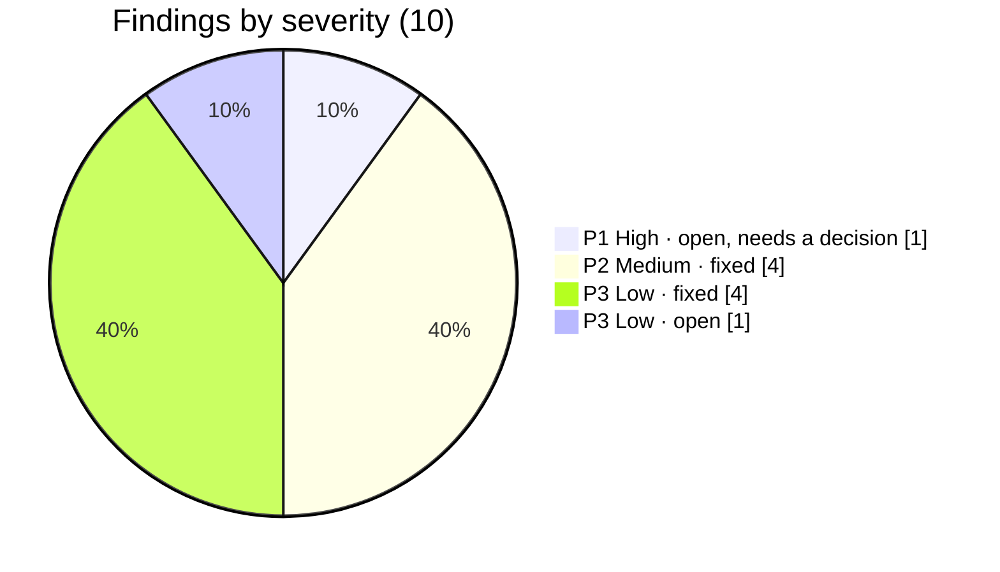
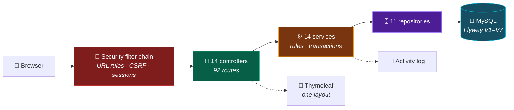
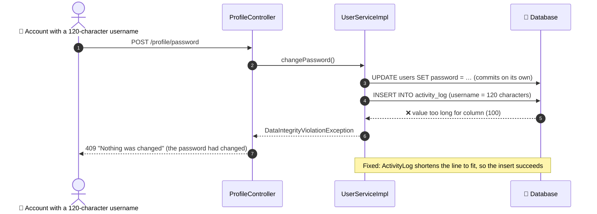

<div align="center">


<br/>

# 🔎 Project Audit Report

**A full review of the codebase: what works, what was broken, what was fixed, and what is left**


*Reviewed on top of commit `5eb9b8e` plus the uncommitted Stage G work in the working tree.
Issue numbers continue the [Engineering Backlog](project_analysis.md#-engineering-backlog).*

[📘 README](README.md) · [📋 Analysis](project_analysis.md) · [✅ Task Board](TASKS.md) · [🗺️ Roadmap](PROJECT_ROADMAP.md)

</div>

---

## 📑 Contents

| | Section | | Section |
|:---:|---|:---:|---|
| 1 | 📌 [Executive Summary](#-executive-summary) | 7 | 🔧 [Implementation Log](#-implementation-log) |
| 2 | 🧰 [Technology Stack](#-technology-stack) | 8 | 🧪 [Testing and Build Results](#-testing-and-build-results) |
| 3 | 🧱 [Architecture Review](#-architecture-review) | 9 | 💾 [Database and API Review](#-database-and-api-review) |
| 4 | 🧩 [Feature Completion Matrix](#-feature-completion-matrix) | 10 | 🚧 [Remaining Work](#-remaining-work) |
| 5 | 🐞 [Defect Register](#-defect-register) | 11 | 🏃 [Run and Deployment](#-run-and-deployment) |
| 6 | 🔐 [Security Findings](#-security-findings) | 12 | 🏁 [Final Assessment](#-final-assessment) |

---

## 📌 Executive Summary

**Student Management System** is a server-rendered Spring Boot application that runs a college's records:
students, teachers, courses, subjects, enrollments, attendance, exams, results and fees, behind a login with
three roles (Admin, Teacher, Student). It has 92 HTTP endpoints, 11 JPA entities, a Flyway-versioned MySQL
schema, PDF and CSV output, and a test suite that runs on in-memory H2.

**The starting point was healthy.** The baseline suite passed (100 of 100). Every template link points at a
real route, every query is parameterised, no template uses `th:utext`, every change is a POST with a CSRF
token, and controllers never touch repositories. The problems were at the edges, where input is longer,
repeated or larger than expected, plus one gap in the safety net: the role rules had no automated test.

**What the audit found and did:**



- 🔧 **Eight defects fixed (#39–#46)**, each with a test written first and seen to fail. Examples: long text lost the
  user's form behind a misleading error page; a password change could succeed and still report that nothing
  had changed; a student could get two results for one exam, which the marksheet counted twice.
- 🛡️ **The role rules are now tested on every build.** `RouteAccessTest` sends all 92 routes as Admin, Teacher,
  Student and a signed-out visitor. With the "fees are admin-only" rule deleted on purpose, it failed on all 16
  teacher and student fee requests.
- 🟠 **One high-severity item needs a decision (#38).** Anyone can register, and every signed-in account
  can read every student's contact details, marks and attendance. That is how v1 was designed, and Stage I
  will close it, but it must be settled before real student data goes online (task H7).
- 🗄️ **One migration added (V7)**, verified on real MySQL. The local `sms_web` database has no duplicate results, so V7
  will apply there on the app's next start, after a backup, as CLAUDE.md asks.

> ⚠️ **Not verified here:** GitHub Actions (nothing was pushed), PDF and CSV output (unchanged, last checked
> on 9 Oct), and the owner's running copy on `:8080`, which was left alone.

---

## 🧰 Technology Stack

Read from `pom.xml`, the Spring Boot 3.5.16 dependency list, and the running application.

| Layer | Technology | Version |
|---|---|---|
| ☕ Language | Java (compiled for 21; this machine runs JDK 25.0.3) | 21 |
| 🍃 Framework | Spring Boot · Spring Framework | 3.5.16 · 6.2.19 |
| 🔐 Security | Spring Security, `thymeleaf-extras-springsecurity6` | 6.5.11 |
| 🗄️ Persistence | Spring Data JPA · Hibernate ORM | 6.6.53 |
| 🐬 Database | MySQL Server (local `MySQL80` service) · Connector/J | 8.0 · 9.7.0 |
| 🧭 Migrations | Flyway (`flyway-core`, `flyway-mysql`) | 11.7.2 |
| 🎨 Views | Thymeleaf · Bootstrap · Bootstrap Icons · Chart.js (from jsDelivr) | 3.1.5 · 5.3.8 · 1.11.3 · 4.4.3 |
| 📄 Documents | OpenPDF · Apache Commons CSV | 3.0.5 · 1.14.1 |
| 🧪 Tests | JUnit 5 · AssertJ · Mockito · Spring Security Test · H2 (MySQL mode) | H2 2.3.232 |
| 🛠️ Build and CI | Maven wrapper · GitHub Actions (`./mvnw -B test` on Java 21) | — |

No Docker, actuator, REST API or external services are present. All of them are planned (Stages H, N, L).

---

## 🧱 Architecture Review



<table>
<tr>
<td width="50%" valign="top">

**✅ Strengths**

- Strict layering: no controller imports a repository (checked)
- Every page renders through `LayoutView`, error branches included
- One source of truth for grades, passwords, uploads and paging, and now field lengths (`FieldLimits`)
- Parent deletes clear their children in one transaction, proven by `DeleteCascadeTest`
- Flyway owns the schema; Hibernate only validates

</td>
<td width="50%" valign="top">

**⚠️ Weaknesses**

- Forms bind entities directly. That is safe while only admins and teachers post them, but the student self-service
  pages (I9) must use DTOs, as planned
- The activity log is written after the change, outside its transaction. Since #40 it can't fail on length, but
  a database error at that moment would still show an error page for a saved change
- `spring.jpa.open-in-view` is on by default (Spring logs a warning); templates rely on it for lazy fields
- Viewing permissions are coarse until Stage I (#38)

</td>
</tr>
</table>

**Recommendations** (none of them needs new infrastructure): move activity logging to an after-commit listener when
Stage L adds domain events (L5); keep DTOs for every form a student can post (I9) and for the REST API (N1);
leave open-in-view on for the web pages, and keep it out of the API's design.

---

## 🧩 Feature Completion Matrix

Status is from evidence gathered in this audit (tests, a MySQL run, curl), unless the row says otherwise.

| Feature | Status | Evidence |
|---|:---:|---|
| 🔐 Sign-in, sign-out, registration, roles | ✅ COMPLETE | `RegistrationTest`, `RouteAccessTest`, curl sign-in on MySQL as `demo_admin` and `demo_teacher` |
| 👤 Profile and password change | ✅ COMPLETE | `FieldLengthTest` (now works for long usernames too, #40) |
| 🛠️ User admin: enable, role, link to a person, sign-out at once | ✅ COMPLETE | `AccountLinkTest`, `SessionExpiryTest` |
| 👨‍🎓 Students: CRUD, photo, search, paging, marksheet | ✅ COMPLETE | `DeleteCascadeTest`, `MarksheetTest`, `FieldLengthTest`, `FileUploadUtilTest` |
| 📥 Student CSV import and export | ✅ COMPLETE | `CsvHelperTest`; import rows now also get the length messages |
| 👨‍🏫 Teachers · 📚 Courses with curriculum · 📖 Subjects · 📝 Enrollments | ✅ COMPLETE | `CurriculumTest`, `DeleteCascadeTest` |
| 🗓️ Attendance: single, bulk, report | ✅ COMPLETE | `FormMessagesTest`, `SearchRepositoryTest`, `FieldLengthTest` |
| 🧾 Exams · 🏆 Results · grade engine | ✅ COMPLETE | `GradeCalculatorTest`, `ResultDuplicateTest`, `FormMessagesTest`; curl on MySQL |
| 💰 Fees: receipt, overdue, export | ✅ COMPLETE | `FeeTotalsTest`; admin-only proven by `RouteAccessTest` |
| 📊 Dashboard · 🔔 notifications · 📰 activity | ✅ COMPLETE | Pages render for every role in `RouteAccessTest`; demo data on MySQL |
| 🖨️ Marksheet and receipt PDFs | ❔ UNVERIFIED here | Untouched by this audit; read back by hand on 9 Oct (project_analysis) |
| 🛡️ "Own records only" for students and teachers | 🟡 PARTIAL | `AccessRules` exists and is tested (G11); no page uses it yet (Stage I) → #38 |
| 🗄️ Flyway migrations V1–V7 | ✅ COMPLETE | Run on empty MySQL; app started with `validate`; V7 refuses duplicates cleanly |
| 🌱 Demo data | ✅ COMPLETE | `DemoDataSeederTest`; seeded on MySQL with V7 in place |
| ⚙️ CI | ❔ UNVERIFIED here | Workflow unchanged and green per F18; this audit's changes not pushed |
| 🐳 Docker, live demo, health check | ❌ MISSING (planned) | Stage H, next on the board |
| 🔑 Password reset, email | ❌ MISSING (planned) | Stage L (L1, L2) |
| 🔌 REST API | ➖ NOT APPLICABLE yet | Stage N |

---

## 🐞 Defect Register

| # | Sev | Defect | Root cause | Fix | Test | Status |
|:---:|:---:|---|---|---|---|:---:|
| 38 | 🟠 P1 | Anyone can register, and every signed-in account can read every student's personal details, marks and attendance | v1 design: viewing is open to all roles; I5 is not built yet | Decision needed (see [Remaining Work](#-remaining-work)) | — | 🟠 Open |
| 39 | 🟡 P2 | Text over 255 characters lost the form behind a 409 page that said "Nothing was changed" | No `@Size` on any text field; the `VARCHAR(255)` column refused it | `@Size` on 23 fields from one `FieldLimits`; three forms now show the message | `FieldLengthTest` ×4 | ✅ Fixed |
| 40 | 🟡 P2 | A password change by a 101+ character username was saved, then the user saw 409 "Nothing was changed" | The audit line is written after the change, outside its transaction, and overflowed `activity_log.username` (100) | `ActivityLog` shortens lines to fit; usernames capped at 50 | `FieldLengthTest` ×2 | ✅ Fixed |
| 41 | 🟡 P2 | A student could get two results for one exam; the marksheet counted it twice | No check on the form, no constraint in the database | Form check plus `uk_results_student_exam` (V7) | `ResultDuplicateTest` ×3 | ✅ Fixed |
| 42 | 🟡 P2 | Role rules had no automated test: 8 403 checks, the 51/51 matrix was run by hand once | — | `RouteAccessTest` over all 92 routes and 4 identities; fails when a route has no rule | `RouteAccessTest` ×3 + mutation check | ✅ Fixed |
| 43 | 🔵 P3 | Registration printed any exception's text, which can include SQL | `catch (RuntimeException ex)` → `ex.getMessage()` on the page | Service throws its own messages only; a save-time clash becomes a plain message | `RegistrationClashTest` | ✅ Fixed |
| 44 | 🔵 P3 | The demo seeder logged the demo password, including a custom one | Value passed to `log.info` | Logs the setting's name, not its value | Read in the diff (no test) | ✅ Fixed |
| 45 | 🔵 P3 | An exam could be out of more than 1000 marks, the most a result can hold | No upper bound on `Exam.totalMarks` | `@Max(GradeCalculator.MAX_MARKS)` | `FormMessagesTest` | ✅ Fixed |
| 46 | 🔵 P3 | A photo was decoded before its size was checked: a small file could make the server allocate gigabytes (admins only) | `reader.read(0)` with no dimension check | Refuse over 40 megapixels before decoding | `FileUploadUtilTest` ×3 | ✅ Fixed |
| 47 | 🔵 P3 | A non-English password within 72 characters but over 72 bytes passes the rule, then the encoder refuses it with its own message; as `ADMIN_PASSWORD` it stops startup | `PasswordPolicy` counts characters, BCrypt counts bytes (checked with Spring Security 6.5.11: 30 Devanagari letters = 90 bytes → refused) | Count UTF-8 bytes in `PasswordPolicy`, with a small custom constraint | — | 🟡 Open |

**How #40 happened, step by step:**



<details>
<summary><b>🔍 Observations that are not defects</b> (recorded, not changed)</summary>

<br/>

| # | Observation | Why it was left | Suggested home |
|:---:|---|---|---|
| O1 | Changing your own password leaves your other sessions signed in | G5 covers disable and role change; a reset is planned to reuse it | L2 |
| O2 | Registration says whether a username or email is taken | A common trade-off for sign-up forms; the reset form is designed not to reveal it | L2, L3 |
| O3 | No limit on failed sign-ins | Planned | P4, N6 |
| O4 | Bulk attendance lists every student, not just those whose course teaches the subject | E14 asked for "every student"; the curriculum (G9) now allows narrowing | I6–I8 |
| O5 | 3 of the 7 CDN files have no `integrity` attribute | Part of the planned header and CSP work | P3 |
| O6 | `.env` is not in `.gitignore` | No `.env` exists yet; H2 introduces `.env.example` | H2 |
| O7 | A fee can be marked Paid with no payment date | Data quality only; nothing breaks | K3 |
| O8 | An enrollment's course need not be the student's own course | May be intended (electives); a product decision | I1 |

</details>

---

## 🔐 Security Findings

No secret was printed while auditing. Passwords were passed to the MySQL client through `MYSQL_PWD` only.

| Area | Finding | Status |
|---|---|:---:|
| 🔑 Authentication | BCrypt, one 8–72 rule, CSRF on every POST, POST-only sign-out, sessions ended on disable or role change | ✅ Sound |
| 🛡️ Authorization (URLs) | Every route behaves as the README's role table says, for every role; now enforced by a test (#42) | ✅ Fixed |
| 👁️ Authorization (data) | Any signed-in account can read every student's records; registration is open (#38) | 🟠 Open |
| 💉 Injection | All JPQL and the one native query use bound parameters; no string-built SQL | ✅ Sound |
| 🧾 XSS | No `th:utext`; no user data in inline scripts; the 13 inline handlers are fixed strings | ✅ Sound |
| 📦 Uploads | Content type, full decode, 2 MB cap, generated names, path-checked delete; now a pixel limit (#46) | ✅ Fixed |
| 🗣️ Error text | Registration could show SQL text (#43); other error pages show no stack traces | ✅ Fixed |
| 📝 Logs | The demo password was logged (#44) | ✅ Fixed |
| 🔐 Secrets | DB and admin credentials come from the environment; the app uses `sms_app`, limited to `sms_web` | ✅ Sound |
| 🕰️ History | The old `root` password is still in git history and not rotated (#5) | 🟡 Open |
| 🔢 Password bytes | Multi-byte passwords near the limit get the encoder's message (#47) | 🟡 Open |

---

## 🔧 Implementation Log

Paths are under `Student-Management-System-web/src/`. Every change follows the existing style: constructor
injection, no Lombok, comments that cite the issue.

| Fix | Files | Why |
|---|---|---|
| #39 | `main/java/.../utility/FieldLimits.java` *(new)* · `entity/Student`, `Teacher`, `Course`, `Subject`, `Exam`, `Attendance` · `dto/BulkAttendanceForm`, `UserRegistrationDto` · `templates/course/course-form.html`, `attendance/attendance-form.html`, `attendance/attendance-bulk.html` | One limit and one message pattern for every text field. The three templates did not show errors for these fields, so a refused value would have come back with no message |
| #40 | `entity/ActivityLog.java` | Lines are shortened to the column sizes, without splitting a two-`char` character |
| #41 | `entity/Result.java` · `repository/ResultRepository.java` · `service/ResultService.java` · `service/impl/ResultServiceImpl.java` · `controller/ResultController.java` · `resources/db/migration/V7__results_unique.sql` *(new)* | Same pattern as the attendance fix #35: `existsBy…AndIdNot` on the form, a named unique constraint in the database |
| #42 | `test/.../controller/RouteAccessTest.java` *(new)* | The matrix is written out per route and does not read `SecurityConfig`, so a wrong rule can't hide |
| #43 | `service/UserService.java` · `service/impl/UserServiceImpl.java` · `controller/AuthController.java` | The controller catches only `IllegalArgumentException`, whose messages the service writes |
| #44 | `config/DemoDataSeeder.java` | Prints the setting's name, not its value |
| #45 | `utility/GradeCalculator.java` · `entity/Exam.java` · `entity/Result.java` | `MAX_MARKS` is shared by the exam total and the result cap |
| #46 | `utility/FileUploadUtil.java` | Width × height is read from the header before decoding |
| Docs | `README.md` · `PROJECT_ROADMAP.md` · `project_analysis.md` · `TASKS.md` · `CLAUDE.md` · this report | Counts recounted from source; I8's text updated because V7 already adds its constraint; the #38 decision put ahead of H7 |

**New tests:** `FieldLengthTest` (6), `ResultDuplicateTest` (3), `RouteAccessTest` (3), `FileUploadUtilTest` (3),
`RegistrationClashTest` (1), and one more case in `FormMessagesTest`. No existing test was changed, skipped or removed.

---

## 🧪 Testing and Build Results

All commands ran from `Student-Management-System-web/` on Windows 11 with JDK 25.0.3.

| Check | Command or method | Result |
|---|---|:---:|
| Baseline suite, default memory | `./mvnw test` | ⛔ BLOCKED: the test JVM could not start, "The paging file is too small" (Windows error 1455, 0.4 GB of commit memory left on the machine) |
| Baseline suite, smaller heap | `MAVEN_OPTS=-Xmx256m ./mvnw test -DargLine="-Xmx448m -XX:+UseSerialGC"` | ✅ PASSED · 100 tests, 0 failures |
| Each new test before its fix | `./mvnw test -Dtest=…` | ❌ FAILED as intended: 409 instead of a form (×3), a 51-character username accepted, 409 after a saved password change, a duplicate result saved and accepted by the database, a 1500-mark exam saved, SQL text passed through, a 100-megapixel picture decoded |
| Full suite after all fixes | `./mvnw clean test` (same memory flags) | ✅ PASSED · **117 tests, 0 failures, 0 errors, 0 skipped** |
| Route test has teeth | Deleted the fee rule in `SecurityConfig`, ran `RouteAccessTest`, restored the file byte for byte | ✅ Failed on 16 requests as it should; file identical afterwards (`cmp`) |
| Template links | Node script: every `@{…}` in the templates against every mapping | ✅ PASSED · all links resolve · 92 endpoints (60 GET, 32 POST) |
| Package | `./mvnw package -Dmaven.test.skip=true` | ✅ PASSED |
| Migrations on MySQL | V1–V7 with the `mysql` client on an empty throwaway schema | ✅ PASSED · `uk_results_student_exam` created |
| V7 against existing duplicates | V1–V6, a planted duplicate result, then V7 | ✅ Refused with error 1062; both rows and the schema unchanged |
| App on MySQL | The jar on `:8091`, `demo` profile, throwaway schema | ✅ PASSED · Flyway applied V1–V7, Hibernate validation passed, demo data loaded |
| End-to-end on MySQL | curl with a cookie jar per account | ✅ PASSED · second result refused with its message, edit still saves, a 300-character description comes back with its message and the typed text, a valid course saves |
| Local `sms_web` | Read-only queries as `sms_app` | ✅ `sms_web` at V6, 2 results, no duplicate pairs |
| GitHub Actions | — | ⏸️ NOT RUN · nothing pushed |
| PDFs and CSV files | — | ⏸️ NOT RUN · code unchanged |

<sub>The throwaway schema `sms_v7_check` was dropped and the `:8091` process stopped afterwards. The owner's app on `:8080`,
the `sms_web` data and MySQL's `root` account were not changed.</sub>

---

## 💾 Database and API Review

- **Schema:** 12 tables (11 entities plus `course_subjects`), 14 foreign keys, and now **11** unique constraints. All
  text columns are `VARCHAR(255)`, which the forms now enforce. The marks cap (≤ 1000) was in the database as a
  `CHECK`, and now the exam form enforces it too.
- **New migration:** `V7__results_unique.sql` adds `uk_results_student_exam (student_id, exam_id)`. If duplicates
  exist it fails with error 1062 and changes nothing; the file explains how to find and remove them. `Result`
  declares the same constraint, so the H2 tests enforce it too.
- **Before the next start on `sms_web`:** V7 will run there. A read-only check found no duplicates, so it will
  apply. Back up first, as CLAUDE.md says:
  `mysqldump --single-transaction -u sms_app -p sms_web > sms_web-before-v7.sql`
- **Routes:** unchanged, still 92. No URL, parameter or page changed shape. The only visible changes are new
  messages on forms.
- **No public API** exists yet. When Stage N adds one, `RouteAccessTest`'s completeness check will force each
  new route into the matrix.

---

## 🚧 Remaining Work

| Priority | Item | Why |
|:---:|---|---|
| 🟠 1 | **Decide #38 before H7.** Either keep the public demo on made-up data only, or build I5 first, or make new accounts wait for an admin's approval | Real student data must not be readable by anyone who signs up |
| 🟡 2 | Back up `sms_web`, then start the app so V7 applies | Puts the one-result rule into the existing data too |
| 🟡 3 | Commit this work. It sits on top of the uncommitted Stage G changes, so commit Stage G first, then the audit fixes as their own commit | One task per commit, as CLAUDE.md asks |
| 🔵 4 | Fix #47: count password bytes in `PasswordPolicy` | Rare, but it can stop startup |
| 🔵 5 | Rotate the old `root` password (#5, task A4) | Only the other local projects still use `root` |
| ⚪ 6 | Observations O1–O8 at their suggested stages | None is urgent |

---

## 🏃 Run and Deployment

Verified in this audit, from `Student-Management-System-web/`:

```bash
# Tests (H2, no MySQL needed). On a machine short of memory, add the flags shown.
MAVEN_OPTS=-Xmx256m ./mvnw test -DargLine="-Xmx448m -XX:+UseSerialGC"

# The app, as sms_app (DB_USERNAME / DB_PASSWORD set in the environment)
./mvnw spring-boot:run

# A sample college on an empty database: demo_admin / demo_teacher / demo_student
./mvnw spring-boot:run -Dspring-boot.run.profiles=demo
```

Environment variables (names only): `DB_USERNAME`, `DB_PASSWORD`, optional `ADMIN_USERNAME`, `ADMIN_PASSWORD`,
`ADMIN_EMAIL`, `INSTITUTION_NAME`, and `sms.demo.password` for the demo profile. **Deployment is not set up yet:**
Docker, a production profile and hosting are Stage H.

---

## 🏁 Final Assessment

<div align="center">


</div>

| | What |
|---|---|
| ✅ **Implemented and verified** | #39–#43, #45, #46: each by a test that failed first, plus V7 and the length limit on real MySQL |
| ☑️ **Implemented, not fully verified** | #44 (a log line; checked in the diff, no test) · CI on GitHub (not pushed) |
| 🟡 **Partially implemented** | Record-level permissions: the `AccessRules` bean exists and is tested, no page uses it yet (#38) |
| ❌ **Not implemented** | #47 · Stage H onward (Docker, live demo, password reset, REST API) |
| ⛔ **Blocked** | Nothing in the code. The default test run needs the memory flags on this machine |

**Overall:** the application works, its data rules are tighter than before, and its access rules are now
guarded by a test that runs on every build. It is ready for Stage H on made-up data. It is not ready to hold
real student data on the internet until #38 is settled.
