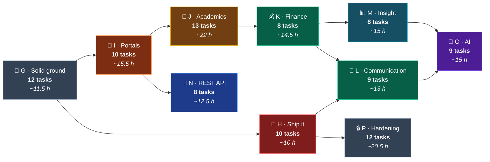

<div align="center">


<br/>

# ✅ Task Board

**Version 2: from a records system to a campus platform, one sitting at a time**


*v2 planned on 9 Oct 2026 from commit `5eb9b8e` · the finished v1 board (Stages 0–F) is [archived at the bottom](#-archive--v1-board-stages-0f)*

[📘 README](README.md) · [📋 Analysis](project_analysis.md) · [🌟 Roadmap v2](PROJECT_ROADMAP.md#-roadmap-v2)

</div>

---

## 🧭 How to Use This Board

1. **Stages run in order; tasks run top to bottom.** When a task depends on one from another stage, it says 🔗 **Needs**. The [dependency map](PROJECT_ROADMAP.md#-roadmap-v2) in the roadmap shows which stages could overlap.
2. **Each task is one sitting and one commit.** Tasks take between 15 minutes and 3 hours.
3. **Keep two habits from v1.** Every new route goes into the route × role security test (`RouteAccessTest`, which fails until a new route has a line in its matrix), and every new feature ships with at least one test. From G7 on, every schema change is a new Flyway migration; never edit one that is already merged.
4. **Run the ✅ Done when check** in the running app, tick the box (`- [ ]` → `- [x]`), and update the **Done** column below.

> ⚠️ **Decide #38 before the public deploy (H7).** Until I5, every signed-in account, a self-registered one
> included, can view every student's records. That's fine with the made-up demo data. With real data, do I5
> first, or make new accounts wait for an admin's approval. Details in the [audit report](PROJECT_AUDIT_REPORT.md).

| Symbol | Meaning |
|:---:|---|
| `#33` | Issue number in the [Engineering Backlog](project_analysis.md#-engineering-backlog) |
| ⏱ | Rough time estimate |
| 📂 | Files to change. Java paths are relative to `Student-Management-System-web/src/main/java/com/anurag/sms/`, templates to `…/src/main/resources/templates/`, and migrations live in `…/src/main/resources/db/migration/` |
| 🔗 | Another task that has to be done first |
| ✅ | How to check the task is finished |
| 🎯 | A release worth announcing (live demo, platform, AI) |

<sub>Run commands from `Student-Management-System-web/`: `./mvnw spring-boot:run` in Git Bash, `.\mvnw.cmd spring-boot:run` in PowerShell.
Suggested commit style: `feat(portal): student home page (I3)`.</sub>

---

## 📊 Progress

| Stage | Release | What it gets you | Tasks | Time | Done |
|---|:---:|---|:---:|:---:|:---:|
| 🧱 [G · Solid Ground](#-stage-g--solid-ground) | `v1.1` | Open backlog closed, Flyway migrations, real course links, accounts linked to people, demo data | 12 | ~11.5 h | ✅ 12 / 12 |
| 🚀 [H · Ship It](#-stage-h--ship-it) | `v1.2` 🎯 | Docker, a public live demo, MySQL integration tests, coverage, CodeQL | 10 | ~10 h | 0 / 10 |
| 🎒 [I · Self-Service Portals](#-stage-i--self-service-portals) | `v1.3` | Student and teacher homes, "My" pages, ownership rules, gradebook | 10 | ~15.5 h | 0 / 10 |
| 🏫 [J · Academic Operations](#-stage-j--academic-operations) | `v1.4` | Terms, timetable, announcements, assignments, leave, calendar, SGPA/CGPA, report cards | 13 | ~22 h | 0 / 13 |
| 💰 [K · Finance](#-stage-k--finance) | `v1.5` | Fee structures, invoices, partial payments, fines, scholarships, Razorpay, reports | 8 | ~14.5 h | 0 / 8 |
| 📣 [L · Communication](#-stage-l--communication--automation) | `v1.6` | Email, password reset, inbox, domain events, scheduled reminders, live bell | 9 | ~13 h | 0 / 9 |
| 📊 [M · Insight & Documents](#-stage-m--insight--documents) | `v1.7` | Analytics, at-risk flags, Excel, verifiable ID cards and certificates, QR attendance | 8 | ~15 h | 0 / 8 |
| 🔌 [N · REST API](#-stage-n--rest-api) | `v2.0` 🎯 | JWT-secured JSON API, OpenAPI docs, rate limits, contract tests | 8 | ~12.5 h | 0 / 8 |
| 🤖 [O · AI Assistant](#-stage-o--ai-assistant-claude-api) | `v2.1` 🎯 | Report-card remarks, a student chatbot, plain-English analytics, CSV mapping | 9 | ~15 h | 0 / 9 |
| 🔒 [P · Production Hardening](#-stage-p--production-hardening) | `v2.2` | Metrics, CSP, 2FA, change history, performance, Hindi, dark mode, backups | 12 | ~20.5 h | 0 / 12 |
| | | **Total** | **99** | **~150 h** | **12 / 99** |



<sub>An arrow means at least one task in the later stage needs a task in the earlier one. N and P depend on little, so they can run alongside the others.</sub>

> 🎯 **Placement fast track (~35 h, about 3 weeks at 12 h a week).** If interviews are close, do these first:
> all of **G** and **H** (a live demo link), then **I1–I5** (three real portals), then **O1, O2 and O4** (an AI helpdesk
> on the student portal). That gives a recruiter a URL, three logins that each show something different,
> and an AI feature that is safe by design.

---

## 🧱 Stage G · Solid Ground

**Goal:** close the open backlog, put the database schema under version control, and fix the two modelling weaknesses, so that every later stage builds on real relationships. · **Release** `v1.1`

> 💡 **Why this comes first.** Stages I–P add about 20 tables. With `ddl-auto=update` there is no record of what
> changed, no way to backfill data, and no safe way to rename a column. Flyway (G7) fixes that, and the
> User → Student link (G10) is what every portal page in Stage I depends on.

> 📝 **Done 11 Oct 2026, with these decisions and extras:**
> - **G1:** `messages.properties` also covers `Long`, `Double`, `BigDecimal`, `LocalDate`, and a plain `typeMismatch` fallback.
> - **G2:** the card shows "₹X pending" as money, not a count. On the demo data: ₹1,030,000 collected and ₹235,000 pending, matching the fee rows exactly.
> - **G3:** besides the form check, `V2__attendance_unique.sql` adds a unique index on (student, subject, date), as enrollments already had.
> - **G4:** the rule is 8 to **72** characters: Spring Security's BCrypt rejects longer passwords, which the old 100-character limit allowed through. `AdminSeeder` follows it too. **Found and fixed:** any validation error on the registration form gave a 500 page, because the form was bound as `userRegistrationDto` while the page reads `user`; the page also showed no field errors. Both are covered by `RegistrationTest`.
> - **G5:** `UserService` ends the sessions, so any future caller gets it too (L2's password reset will reuse it). The login page explains the sign-out. Only a real change signs anyone out; re-enabling an account does not need to.
> - **G7:** Flyway 11 accepted MySQL 8.0.46. `V1__baseline.sql` keeps Hibernate's generated constraint names so that a fresh database and an existing one stay identical for later migrations. Checked both ways: an empty schema ran V1–V6, and `sms_web` was baselined at V1 and then ran V2–V6.
> - **G8:** V3 stops with MySQL error 1138 if any student's course text matches no course (checked on a scratch schema); V4 drops the old column. A course that still has students can't be deleted; the list says why. Your 4 students moved to the right courses.
> - **G9:** the curriculum is backfilled from existing enrollments, so none of them became invalid. **Found and fixed before it shipped:** saving the course form would have wiped the course's subjects, because the posted course carries an empty list; the service now copies only the form's fields onto the stored course. Removing a subject that enrollments still use is refused. The subject page lists the courses that teach it.
> - **G10:** deleting a student or teacher keeps their account and drops the link. A new role drops a link that no longer fits it.
> - **G11:** the bean is `security/AccessRules`, with `isOwnStudent` and `isOwnTeacher`. `AccessRulesTest` runs the exact `@PreAuthorize` expression Stage I will use.
> - **G12:** 3 courses, 8 subjects, 5 teachers, 30 students, 102 enrollments, 3,060 attendance records, 102 results and 60 fees. Three students fall under 75%, 6 tuition fees are overdue, and a unit test is always 3 days away. Password `demo12345`, or set `sms.demo.password`.
> - **Tests:** 100 (from 55) in 16 classes, plus a 20-step browser check with curl against MySQL with the demo data.
> - **G6:** before any other project's code was touched, every project on E: and in the home folder was searched; none reads `DB_USERNAME` or `DB_PASSWORD`. Because `DB_PASSWORD` was the only stored copy of `root`'s password, that value was first kept in a new user variable, `MYSQL_ROOT_PASSWORD`. `sms_app` got a random 24-character password and `ALL` on `sms_web` only; it is refused on other databases. The app then started as `sms_app`, and Flyway found the schema up to date.

**🧹 Backlog clean-up** · issues #33–#37 and #5

- [x] **G1 · Friendly message for non-numeric input** · `#33` · ⏱ 15 min
  - Create `src/main/resources/messages.properties` with `typeMismatch.java.lang.Integer=Please enter a whole number.`, plus matching lines for `java.math.BigDecimal`, `java.lang.Double` and `java.time.LocalDate`. Spring Boot picks the file up automatically.
  - ✅ **Done when** posting `totalMarks=abc` from DevTools re-shows the exam form with your message instead of "Failed to convert…".

- [x] **G2 · "Fees Collected" counts only paid fees** · `#34` · ⏱ 20 min
  - Rename `FeeRepository.sumAllAmounts()` to `sumPaidAmounts()` and add `WHERE f.paymentStatus = 'Paid'`. Add a second query for the pending total and show it under the card as "₹X pending".
  - 📂 `repository/FeeRepository.java:30` · `service/impl/FeeServiceImpl.java:113` · `dashboard/stats-cards.html`
  - ✅ **Done when** the test data shows ₹60,000 collected and ₹60,000 pending, and a `@DataJpaTest` covers both sums.

- [x] **G3 · Block duplicate attendance on the single form** · `#35` · ⏱ 30 min
  - Reuse `existsByStudentIdAndSubjectIdAndAttendanceDate` in `saveAttendance`; for edits add an `…AndIdNot(id)` variant so a row can keep its own values.
  - ✅ **Done when** a second record for the same student, subject and date shows a field error and nothing is saved.

- [x] **G4 · One password rule everywhere** · `#36` · ⏱ 20 min
  - Add a `PasswordPolicy.MIN_LENGTH = 8` constant and use it in `UserRegistrationDto` and `ChangePasswordDto`. Remove `@Size(min = 6)` from `User.password`: that field holds the 60-character BCrypt hash, so the rule never meant anything there.
  - ✅ **Done when** registering with a 7-character password fails with the same message as the change-password form.

- [x] **G5 · End sessions when an account is disabled or its role changes** · `#37` · ⏱ 1 h
  - Add a `SessionRegistry` bean and an `HttpSessionEventPublisher` bean, and register the registry with `.sessionManagement(s -> s.maximumSessions(-1).sessionRegistry(registry))`.
  - In `AdminUserController`, after a disable or role change, find the user in `registry.getAllPrincipals()` by username and call `expireNow()` on each of their sessions.
  - 📂 `config/SecurityConfig.java` · `controller/AdminUserController.java`
  - ✅ **Done when** a disabled user's open tab is sent to the login page on its next click.

- [x] **G6 · Give the app its own MySQL user** · `#5` · ⏱ 30 min
  - Create `sms_app` with rights on `sms_web` only (`GRANT ALL ON sms_web.* TO 'sms_app'@'localhost'`), then point `DB_USERNAME` and `DB_PASSWORD` at it. A4 was deferred because changing `root` would break 7 other projects. With its own user, this app no longer depends on `root`, and rotating `root` becomes a chore for those other projects.
  - ✅ **Done when** the app runs as `sms_app` and `SHOW GRANTS FOR 'sms_app'@'localhost'` lists only `sms_web`.

**🗄️ Schema under version control**

- [x] **G7 · Add Flyway and baseline today's schema** · ⏱ 1.5 h
  - Add `org.flywaydb:flyway-core` and `org.flywaydb:flyway-mysql` (Spring Boot manages both versions).
  - Run `mysqldump --no-data sms_web > V1__baseline.sql`, strip the `AUTO_INCREMENT=` counters, and save it under `src/main/resources/db/migration/`.
  - Set `spring.flyway.baseline-on-migrate=true` and `spring.flyway.baseline-version=1`, then change `ddl-auto` to `validate`. From now on every schema change is a new `V{n}__*.sql` file, and a merged migration is never edited.
  - In `src/test/resources/application.properties` set `spring.flyway.enabled=false` and keep `create-drop`. The H2 tests stay fast, and H3 runs the real migrations on MySQL.
  - ✅ **Done when** the app starts with `ddl-auto=validate`, `flyway_schema_history` shows version 1, and `./mvnw test` still passes.

- [x] **G8 · Make `Student.course` a real foreign key** · ⏱ 2 h · 🔗 **Needs** G7
  - `V2__student_course_fk.sql`: add `course_id`, fill it with `UPDATE students s JOIN courses c ON LOWER(s.course) = LOWER(c.course_name) SET s.course_id = c.id`, check that no row is left `NULL`, then add `NOT NULL` and the foreign key. Drop the old text column in a later `V3` once everything works.
  - Change the entity to `@ManyToOne Course course`, use a `<select>` on the form, and search with `s.course.courseName`. The CSV import already looks the course up by name, so it only needs to set the entity.
  - 📂 `entity/Student.java` · `student/student-form.html` · `repository/StudentRepository.java` · `utility/CsvHelper.java`
  - ✅ **Done when** every student shows a course picked from the dropdown, the CSV round trip still gives 16 · 0, and all tests pass.

- [x] **G9 · Link subjects to courses (the curriculum)** · ⏱ 1.5 h · 🔗 **Needs** G7
  - A subject can belong to several courses, so add a `course_subjects` join table (`@ManyToMany` on `Course.subjects`). Manage it from the course page with "Add subject" and "Remove" buttons.
  - Make the enrollment form offer only the chosen course's subjects.
  - ✅ **Done when** the course page lists its subjects and the enrollment form can't pair a course with a subject outside it.

- [x] **G10 · Link accounts to people** · ⏱ 1.5 h · 🔗 **Needs** G7
  - Add nullable, unique `users.student_id` and `users.teacher_id` foreign keys (`@OneToOne`). On the Users page, an admin can link an account to a student or a teacher.
  - ~~When someone registers with the email of an existing student, link the account automatically.~~ Moved to L3: until an email address is verified, anyone who knows a student's email could register with it and be linked to their marks and fees.
  - ✅ **Done when** a linked account's profile shows "Linked to Aarav Sharma" and the same student can't be linked to two accounts.

- [x] **G11 · `CurrentUser` helper and an access bean** · ⏱ 1 h · 🔗 **Needs** G10
  - `CurrentUser` returns the signed-in user's student id or teacher id. Turn on `@EnableMethodSecurity` and add an `@Component("access")` with `isOwnStudent(Long id)`, used as `@PreAuthorize("hasRole('ADMIN') or @access.isOwnStudent(#id)")`. Stage I uses it everywhere.
  - ✅ **Done when** unit tests cover admin, owner and non-owner for `isOwnStudent`.

- [x] **G12 · Demo data seeder** · ⏱ 1 h
  - Add a `DemoDataSeeder` under `@Profile("demo")` that, on an empty database only, creates 3 courses, 8 subjects, 30 students, 5 teachers, 6 weeks of attendance, exams, results and fees, plus `demo_admin`, `demo_teacher` and `demo_student` accounts. Use `new Random(42)` so the data is the same on every run, and only invented `@example.com` people.
  - ✅ **Done when** `./mvnw spring-boot:run -Dspring-boot.run.profiles=demo` on an empty schema gives a full dashboard, notifications included.

---

## 🚀 Stage H · Ship It

**Goal:** a public URL a recruiter can open with one click, a one-command local setup, and tests that run on real MySQL. · **Release** `v1.2` 🎯 **Live demo**

- [ ] **H1 · Dockerfile** · ⏱ 1 h
  - Use a multi-stage build: `eclipse-temurin:21-jdk` runs `./mvnw -B package -DskipTests`, then `eclipse-temurin:21-jre` runs the app as a non-root user. Extract the jar's layers with `java -Djarmode=tools -jar app.jar extract --layers --launcher`, so a code change rebuilds only the top layer. Mount `uploads/` as a volume.
  - ✅ **Done when** `docker build -t sms .` succeeds and the image is under 350 MB.

- [ ] **H2 · Docker Compose: app, MySQL and Mailpit** · ⏱ 1 h · 🔗 **Needs** H1, G12
  - `compose.yaml` with `mysql:8.4` (with a healthcheck), the app (with `depends_on: condition: service_healthy`), and `axllent/mailpit` for Stage L. Use named volumes for data and uploads. Commit a `.env.example` and keep the real `.env` out of git.
  - ✅ **Done when** `docker compose up` on a clean machine serves the demo data on `:8080`.

- [ ] **H3 · Integration tests on real MySQL with Testcontainers** · ⏱ 1.5 h · 🔗 **Needs** G7
  - Add `spring-boot-testcontainers`, `org.testcontainers:mysql` and `org.testcontainers:junit-jupiter`. An `AbstractMySqlIT` base declares a `@ServiceConnection MySQLContainer`, so Flyway runs every migration on MySQL 8.4.
  - Move `DeleteCascadeTest`'s scenarios into an `*IT` class run by the Maven Failsafe plugin, so `./mvnw test` stays fast. CI switches to `./mvnw -B verify`; GitHub's runners already have Docker.
  - ✅ **Done when** `./mvnw verify` applies V1…Vn to a fresh container and passes, locally and in CI.

- [ ] **H4 · Code coverage with JaCoCo** · ⏱ 45 min
  - Add `jacoco-maven-plugin` with a `check` rule (start at 60% line coverage and raise it as tests grow). Upload the HTML report as a CI artifact and add a coverage badge (Codecov, or `cicirello/jacoco-badge-generator`).
  - ✅ **Done when** the README shows the coverage figure and CI fails when it drops below the threshold.

- [ ] **H5 · Dependabot and CodeQL** · ⏱ 45 min
  - Add `.github/dependabot.yml` for `maven` and `github-actions` (weekly), plus a CodeQL workflow for Java.
  - ✅ **Done when** the repository's Security tab shows a CodeQL scan and Dependabot has opened its first PR.

- [ ] **H6 · Production profile and health check** · ⏱ 45 min
  - Create `application-prod.properties`: `server.forward-headers-strategy=framework` (the host's proxy terminates HTTPS), `server.servlet.session.cookie.secure=true`, `server.error.include-stacktrace=never`, `spring.thymeleaf.cache=true`.
  - Add `spring-boot-starter-actuator` and expose only `health` and `info`; permit `/actuator/health` in `SecurityConfig`.
  - ✅ **Done when** `/actuator/health` returns `UP` and `/actuator/env` returns 404.

- [ ] **H7 · Deploy to a cloud host** · ⏱ 2 h · 🔗 **Needs** H1, H6, G12
  - Deploy the Docker image to a host that builds from GitHub (Railway or Render, for example), with a managed MySQL 8. Set `SPRING_PROFILES_ACTIVE=prod,demo` and the DB and admin variables in the host's dashboard. Free plans change often and may sleep when idle, so check the current limits and tell visitors the first load can be slow.
  - Container disks are usually wiped on redeploy. Either attach the host's persistent volume to `uploads/` or accept that demo photos reset (H8 re-seeds anyway).
  - ✅ **Done when** the public HTTPS URL shows the login page and the demo accounts work.

- [ ] **H8 · Safe demo mode for strangers** · ⏱ 1 h · 🔗 **Needs** G12, H7
  - In the `demo` profile: show the three demo logins on the login page; block password changes and user-admin actions for demo accounts; and every night run Flyway `clean()` + `migrate()` and re-seed (allow `spring.flyway.clean-disabled=false` in this profile only).
  - ✅ **Done when** a deleted student is back after the reset, and `demo_admin` can't change its password or disable `demo_teacher`.

- [ ] **H9 · Deploy only green builds** · ⏱ 45 min · 🔗 **Needs** H7
  - Turn on the host's "wait for CI" option, or call its deploy hook from a final CI job that needs the test job. Add a **Live demo** badge to the README.
  - ✅ **Done when** a push with a failing test doesn't deploy.

- [ ] **H10 · "Try it live" section in the README** · ⏱ 30 min · 🔗 **Needs** H8
  - Add a demo button, the three logins, what each role can try, and a small deployment diagram.
  - ✅ **Done when** someone new can sign in within 30 seconds of opening the README.

---

## 🎒 Stage I · Self-Service Portals

**Goal:** each role gets a home built for it. A student sees only their own records, and a teacher works only on the subjects they teach. · **Release** `v1.3`

- [ ] **I1 · Assign teachers to subjects** · ⏱ 1.5 h · 🔗 **Needs** G9
  - Add a `TeachingAssignment(teacher, subject)` entity (Stage J adds a term to it). Admins assign subjects from the teacher page.
  - ✅ **Done when** the teacher page lists their subjects and the subject page lists its teachers.

- [ ] **I2 · A dashboard for each role** · ⏱ 1 h · 🔗 **Needs** G10
  - Keep `/dashboard`, but render `dashboard/admin`, `dashboard/teacher` or `dashboard/student` by role. Today's dashboard becomes the admin one.
  - ✅ **Done when** the three demo accounts each land on a different dashboard.

- [ ] **I3 · Student home** · ⏱ 2 h · 🔗 **Needs** I2, G11
  - Cards for attendance % (reuse `AttendanceSummary`), latest results, unpaid fees with due dates, and exams in the next 14 days for the subjects they are enrolled in (`e.subject.id IN (SELECT en.subject.id FROM Enrollment en WHERE en.student.id = :id)`).
  - ✅ **Done when** every number matches what the admin sees for the same student.

- [ ] **I4 · "My" pages for students** · ⏱ 2 h · 🔗 **Needs** I3
  - `/me/marksheet` (with PDF), `/me/attendance` (by subject) and `/me/fees` (with receipt PDFs). Each page reads the student from `CurrentUser`, never from an id in the URL.
  - ✅ **Done when** all three pages work for `demo_student` and none of their URLs contain an id.

- [ ] **I5 · Lock record pages down for students** · ⏱ 1.5 h · 🔗 **Needs** I4
  - Replace the C7 matrix with this one, in `SecurityConfig` and with `@PreAuthorize` on the services, and give students a "My …" sidebar:

    | Area | ADMIN | TEACHER | STUDENT |
    |---|:---:|:---:|:---:|
    | Student, teacher and enrollment pages | ✅ | 👁️ view | ❌ |
    | Course and subject catalogue | ✅ | 👁️ | 👁️ |
    | Attendance, exams, results | ✅ | ✏️ own subjects (I7) | ❌, uses `/me/…` |
    | Fees | ✅ | ❌ | ❌, uses `/me/fees` |

  - Today a student can open `/student/{anyone}/marksheet.pdf`; after this task it returns 403.
  - ✅ **Done when** the route × role test covers every rule in the table and passes.

- [ ] **I6 · Teacher home** · ⏱ 1.5 h · 🔗 **Needs** I1, I2
  - Show their subjects with student counts, whether attendance was taken today for each, and past exams that still have missing results.
  - ✅ **Done when** a teacher sees only their own subjects.

- [ ] **I7 · Teachers act only on their own subjects** · ⏱ 1.5 h · 🔗 **Needs** I1, I6
  - Add `@access.teachesSubject(#subjectId)` to attendance, exam and result changes, and filter the subject dropdowns.
  - ✅ **Done when** a test shows a teacher posting attendance for another teacher's subject gets 403.

- [ ] **I8 · Gradebook: a whole exam's marks in one form** · ⏱ 2 h · 🔗 **Needs** I7
  - Pick an exam to get a table of enrolled students with mark boxes, like bulk attendance (E14). Check every mark against the total and grade each one with `GradeCalculator`. Saving again updates rows instead of adding new ones. ~~First add a unique constraint on `results(student_id, exam_id)` in a migration, after checking for duplicates.~~ Already done by the 11 Oct audit (#41): `V7__results_unique.sql` adds `uk_results_student_exam`, and the result form refuses a second result, so the gradebook only has to update the existing row.
  - ✅ **Done when** 30 results take one submit and a second submit changes marks without creating rows.

- [ ] **I9 · Students edit their own contact details** · ⏱ 1 h · 🔗 **Needs** G10
  - `/me/profile` lets a student change phone, address and photo only. Bind a small DTO, not the `Student` entity, so a crafted POST can't change the name, email or course.
  - ✅ **Done when** a crafted POST with `course=…` leaves the course unchanged.

- [ ] **I10 · Ownership tests** · ⏱ 1.5 h · 🔗 **Needs** I5, I7, I9
  - Cover student A vs student B, teacher on own vs other subject, and admin on everything.
  - ✅ **Done when** at least 15 new security tests pass.

---

## 🏫 Stage J · Academic Operations

**Goal:** model how a college actually runs a year: terms, timetables, coursework, announcements, leave and credit-based grades. · **Release** `v1.4`

**📅 Terms and timetable**

- [ ] **J1 · Academic year and term** · ⏱ 1.5 h · 🔗 **Needs** G7
  - Add `AcademicTerm(name, startDate, endDate, current)`, for example "2026–27 Odd". Allow only one current term (checked in the service).
  - Add a nullable `term_id` to exams, attendance, fees and teaching assignments; the migration creates the first term and fills it in for existing rows.
  - ✅ **Done when** switching the current term changes what the dashboards count.

- [ ] **J2 · Weekly timetable with clash checks** · ⏱ 2.5 h · 🔗 **Needs** J1, I1
  - Add `TimetableSlot(term, course, subject, teacher, dayOfWeek, startTime, endTime, room)`. Reject a slot when the same teacher or the same room already has one that overlaps on that day (`s.startTime < :end AND s.endTime > :start`).
  - ✅ **Done when** an overlapping slot for the same teacher shows an error, and back-to-back slots are allowed.

- [ ] **J3 · Timetable views** · ⏱ 1.5 h · 🔗 **Needs** J2
  - Weekly grids for a course, "my timetable" for a teacher, and one for a student (through enrollments), with print styles.
  - ✅ **Done when** each demo account sees its own week.

- [ ] **J4 · Take attendance from a timetable slot** · ⏱ 1 h · 🔗 **Needs** J2, I6
  - The teacher home lists today's slots, each with a **Take attendance** button that opens the bulk form for that subject and date.
  - ✅ **Done when** one click from a slot opens a pre-filled bulk form.

**📚 Coursework**

- [ ] **J5 · Announcements** · ⏱ 2 h
  - Add `Announcement(title, body, audience, course, pinned, publishAt, expiresAt, author)` with audience All, Students, Teachers or one course. Store the body as plain text and display it with `th:text`, so no HTML is ever rendered.
  - ✅ **Done when** a student sees only announcements meant for them, and expired ones disappear.

- [ ] **J6 · Assignments** · ⏱ 2 h · 🔗 **Needs** I7
  - Add `Assignment(subject, title, description, dueAt, maxMarks, createdBy)`. Teachers manage them for their own subjects; students see those for subjects they're enrolled in.
  - ✅ **Done when** a student enrolled in `MATH01` sees its assignment and other students don't.

- [ ] **J7 · Submissions with file upload** · ⏱ 2.5 h · 🔗 **Needs** J6
  - Add `Submission(assignment, student, file, submittedAt, late, marks, feedback)`. Extend `FileUploadUtil` to accept PDFs up to 5 MB, checking the `%PDF-` signature, not the file name.
  - Store submissions outside the public `/uploads/**` handler and serve them through a controller that checks ownership.
  - ✅ **Done when** a renamed `.exe` is rejected, a late upload is flagged, and student A can't download B's file.

- [ ] **J8 · Grade submissions** · ⏱ 1 h · 🔗 **Needs** J7
  - A teacher sees every submission for an assignment and enters marks and feedback.
  - ✅ **Done when** the student sees their marks and feedback on the assignment page.

- [ ] **J9 · Leave requests** · ⏱ 2 h · 🔗 **Needs** I2
  - Students apply with dates, a reason and an optional document; a teacher or admin approves or rejects. Decide and write down the rule: approved leave days are excused, so they're left out of the attendance total. Update the `AttendanceSummary` queries and their tests to match.
  - ✅ **Done when** approved leave no longer pulls a student under 75%.

- [ ] **J10 · Holidays and an academic calendar** · ⏱ 1.5 h · 🔗 **Needs** J1, J6
  - Add `Holiday(date, name)`; bulk attendance refuses holidays. A calendar page uses FullCalendar (from a CDN) fed by a `/calendar/events` JSON endpoint with exams, holidays and assignment due dates for the signed-in user.
  - ✅ **Done when** each role sees only its own events, and attendance can't be taken on a holiday.

**🎓 Credit-based results**

- [ ] **J11 · SGPA and CGPA** · ⏱ 2 h · 🔗 **Needs** J1
  - Add `GradeCalculator.gradePoint()`: A+ 10 · A 9 · B 8 · C 7 · D 6 · F 0. SGPA is Σ(credits × grade point) ÷ Σ credits for one term, using the existing `Subject.credits`; CGPA covers all terms. Unit-test the formula, including a term with a failed subject.
  - ✅ **Done when** a hand-calculated SGPA for a demo student matches the page.

- [ ] **J12 · Semester report card (PDF)** · ⏱ 1.5 h · 🔗 **Needs** J11
  - One page per term: subjects, credits, grades, SGPA, CGPA, attendance % and a remarks box (Stage O can draft it). Reuse `PdfService`.
  - ✅ **Done when** the PDF matches the report card page.

- [ ] **J13 · Merit list and ranks** · ⏱ 1 h · 🔗 **Needs** J11
  - Rank students by SGPA within a course and term. Equal scores share a rank (1, 2, 2, 4). JPQL has no `RANK()`, so compute it in Java or with a native MySQL 8 query.
  - ✅ **Done when** two students with the same SGPA show the same rank.

---

## 💰 Stage K · Finance

**Goal:** turn single fee rows into a small accounts module: fee structures, instalments, fines, scholarships, online payment and reports. · **Release** `v1.5`

- [ ] **K1 · Fee structure per course and term** · ⏱ 1.5 h · 🔗 **Needs** J1, G8
  - Add `FeeStructure(course, term)` with `FeeComponent(name, amount)` rows such as Tuition, Exam and Library. Use `BigDecimal` with 2 decimal places everywhere.
  - ✅ **Done when** a structure's total equals the sum of its components.

- [ ] **K2 · Generate a term's invoices** · ⏱ 1.5 h · 🔗 **Needs** K1
  - One button creates one fee (invoice) per enrolled student of a course for a term, with a due date. Skip students who already have one, as bulk attendance does.
  - ✅ **Done when** running it twice creates nothing the second time.

- [ ] **K3 · Partial payments** · ⏱ 2.5 h · 🔗 **Needs** K2
  - Move payments out of `Fee` into `Payment(fee, amount, paidOn, method, reference, receivedBy)`. The fee's status is worked out from its payments: Pending, Partly paid, Paid or Overdue. A migration turns each existing paid fee into one payment row. Refuse a payment larger than the balance, and give each payment its own receipt.
  - ✅ **Done when** a ₹60,000 fee paid as three ₹20,000 payments shows Partly paid, then Paid, with three receipts.

- [ ] **K4 · Late fines** · ⏱ 1 h · 🔗 **Needs** K3
  - Add a per-day fine after the due date with a cap (`sms.fees.late-fine-per-day`, `sms.fees.late-fine-max`). Show it on the statement; an admin can waive it, and the waiver is logged.
  - ✅ **Done when** an invoice 10 days overdue shows 10 days' fine, never more than the cap.

- [ ] **K5 · Scholarships and concessions** · ⏱ 1.5 h · 🔗 **Needs** K2
  - Add `Concession(student, term, type, value, reason, approvedBy)`, a percentage or a fixed amount, applied when invoices are generated and shown on the receipt. Decide which components it applies to; tuition only is a sensible default.
  - ✅ **Done when** a 50% scholarship halves only the tuition component.

- [ ] **K6 · Online payment (Razorpay test mode)** · ⏱ 3 h · 🔗 **Needs** K3
  - **Pay now** makes the server create an order with Razorpay's Orders API (amounts in paise), then opens Razorpay Checkout. Record the payment only after the server checks the signature: HMAC-SHA256 of `order_id|payment_id` with the key secret. Never trust the browser's callback alone.
  - Add a webhook endpoint that checks the `X-Razorpay-Signature` header, is exempt from CSRF on that path only, and ignores a payment id it has already recorded. Test keys come from environment variables; Stripe's test mode works the same way if you prefer it.
  - ✅ **Done when** a test-card payment marks the invoice paid, and a test with a tampered signature records nothing.

- [ ] **K7 · Finance reports** · ⏱ 2 h · 🔗 **Needs** K3
  - Collections by month (chart), by course and by payment method; a defaulters list with ageing buckets (0–30, 31–60, 60+ days overdue); CSV export now, Excel in M3.
  - ✅ **Done when** every report total equals the sum of the matching payment rows.

- [ ] **K8 · Money tests** · ⏱ 1.5 h · 🔗 **Needs** K3, K4, K5
  - Cover status rules, fines and the cap, concessions, refused overpayments, and rounding (`HALF_UP` to 2 places).
  - ✅ **Done when** at least 12 tests pass.

---

## 📣 Stage L · Communication & Automation

**Goal:** reach people outside the browser with email, scheduled reminders, an inbox and self-service password reset. · **Release** `v1.6`

- [ ] **L1 · Email** · ⏱ 1.5 h · 🔗 **Needs** H2
  - Add `spring-boot-starter-mail` and an `EmailService` that renders Thymeleaf templates from `templates/email/`. Send with `@Async` from an `@TransactionalEventListener(phase = AFTER_COMMIT)`, so a rolled-back save sends nothing. Use Mailpit locally (SMTP `1025`, inbox UI on `8025`) and a real SMTP service in production. Add a `sms.mail.enabled` switch.
  - ✅ **Done when** a test email appears in Mailpit, and the app still works with mail turned off.

- [ ] **L2 · Forgot and reset password** · ⏱ 2 h · 🔗 **Needs** L1, G5
  - Add `PasswordResetToken(tokenHash, user, expiresAt, usedAt)`. Email a random 32-byte token and store only its SHA-256 hash; it works once and expires after 30 minutes. Show the same message whether or not the email exists, so the form can't be used to discover accounts, and allow one request per email per minute. End the user's sessions after a reset (G5).
  - ✅ **Done when** a link works once, fails after 30 minutes, and an unknown email gets the same message as a known one.

- [ ] **L3 · Verify email on registration** · ⏱ 1 h · 🔗 **Needs** L1
  - New accounts stay disabled until the link in their email is clicked; add a "resend" option.
  - Once the email is verified, link the account to the student with the same email, if that student has no account yet (moved here from G10, where it would have let anyone claim a student's records).
  - ✅ **Done when** an unverified account can't sign in.

- [ ] **L4 · Notification inbox** · ⏱ 2 h
  - Add a `Notification(user, type, title, body, link, readAt, createdAt)` entity for things that happen (assignment graded, leave decided, payment received, new announcement). Rename today's `dto/Notification` record to `Alert` first, so the names don't clash.
  - The bell merges both: live alerts from F1 and unread inbox items. Add "mark read" and "mark all read" as POST actions.
  - ✅ **Done when** approving a leave puts an unread item in the student's bell, and reading it lowers the badge.

- [ ] **L5 · Domain events** · ⏱ 1.5 h · 🔗 **Needs** L4, J9, K3
  - Services publish events such as `LeaveDecided`, `SubmissionGraded`, `PaymentReceived`, `AnnouncementPublished` and `ResultPublished`; listeners create inbox items and emails. Services then don't need to know who listens. The activity log can move to a listener too.
  - ✅ **Done when** no service calls the notification or email code directly.

- [ ] **L6 · Scheduled reminders** · ⏱ 1.5 h · 🔗 **Needs** L1, L5
  - Turn on `@EnableScheduling` and add `@Scheduled(cron = "0 0 8 * * *", zone = "Asia/Kolkata")` jobs: fees due in 3 days, weekly overdue reminders, and a weekly low-attendance digest to students and their teachers. Add ShedLock so two running copies of the app don't both send.
  - ✅ **Done when** a test that runs the job directly finds the expected emails.

- [ ] **L7 · Notification preferences** · ⏱ 1 h · 🔗 **Needs** L4, L6
  - Each user can turn email on or off per category, and every email has a signed unsubscribe link.
  - ✅ **Done when** turning off fee reminders stops only that email.

- [ ] **L8 · Live bell with Server-Sent Events** · ⏱ 1.5 h · 🔗 **Needs** L4
  - Add a `/notifications/stream` endpoint using `SseEmitter` that pushes the unread count. Emitters live in memory, which is fine for one app instance; write that limit down.
  - ✅ **Done when** approving a leave in one browser updates the student's badge in another without a refresh.

- [ ] **L9 · Email tests with GreenMail** · ⏱ 1 h · 🔗 **Needs** L2, L6
  - Use `greenmail-junit5` to check recipients, subjects and that the reset link in the email works.
  - ✅ **Done when** the reset and reminder emails are covered and pass in CI.

---

## 📊 Stage M · Insight & Documents

**Goal:** turn the data into decisions and official documents: analytics, early warnings, Excel, ID cards and verifiable certificates. · **Release** `v1.7`

- [ ] **M1 · Analytics page** · ⏱ 2.5 h · 🔗 **Needs** J1, K3
  - Add `/analytics` for admins with Chart.js: weekly attendance trend, grade distribution per exam, pass rate per subject, collections per month and enrollments per course, filtered by term and course. Fill each chart from a `GROUP BY` query into a record.
  - ✅ **Done when** each chart's numbers match the same SQL run by hand.

- [ ] **M2 · At-risk students (rule-based and explainable)** · ⏱ 2 h · 🔗 **Needs** M1, J8
  - Score each student from 0 to 100 using attendance under 75%, a falling marks trend, failed exams, overdue fees and late or missing submissions. Show each factor's share ("why flagged"), and keep the weights in configuration. Teachers and admins get a list and a weekly alert.
  - ✅ **Done when** a demo student with 60% attendance and a failed exam is listed with both reasons.

- [ ] **M3 · Excel export with Apache POI** · ⏱ 1.5 h
  - Add `poi-ooxml` and use `SXSSFWorkbook`, which streams rows instead of holding them all in memory. Export students, the attendance report, results per exam and the finance reports, with a bold frozen header, auto-filter, and real number and date cells.
  - ✅ **Done when** the files open in Excel with filters on and dates sortable as dates.

- [ ] **M4 · Public document verification** · ⏱ 1.5 h
  - Add a `DocumentVerification(token, type, subjectId, issuedAt, revokedAt)` table with random 128-bit tokens, and a public `/verify/{token}` page that shows only the name, course, document type and whether it's valid. Rate-limit the page.
  - ✅ **Done when** a valid token shows the details, and a changed or revoked one shows "not valid".

- [ ] **M5 · Student ID card with a QR code** · ⏱ 2 h · 🔗 **Needs** M4
  - Use ZXing (`com.google.zxing:core` and `javase`) to draw a QR code holding the M4 verification link, and lay out a card with the photo in OpenPDF, 8 cards to an A4 sheet.
  - ✅ **Done when** scanning a printed card with a phone opens its verification page.

- [ ] **M6 · Certificates** · ⏱ 1.5 h · 🔗 **Needs** M4
  - Students request a bonafide or course-completion certificate, an admin approves it, and the PDF has a serial number and a verification QR code.
  - ✅ **Done when** an approved request downloads a certificate whose QR code verifies.

- [ ] **M7 · QR attendance (stretch)** · ⏱ 2.5 h · 🔗 **Needs** J2, M5
  - The teacher shows a QR code that changes every 30 seconds and is tied to the current timetable slot. A signed-in student scans it to mark themselves present; old codes and second scans are refused. Be honest in the README that a student could forward the code; the 30-second rotation is the mitigation.
  - ✅ **Done when** a code older than 30 seconds is refused, and a student can't mark themselves twice.

- [ ] **M8 · Command palette search (Ctrl+K)** · ⏱ 1.5 h · 🔗 **Needs** I5
  - One box that searches students, teachers, courses and subjects through a JSON endpoint, filtered by role.
  - ✅ **Done when** typing `MATH` finds the subject, and a student's results include only what they are allowed to open.

---

## 🔌 Stage N · REST API

**Goal:** expose the system as a secured, documented JSON API, ready for a mobile app or a React front end. · **Release** `v2.0` 🎯 **Platform**

- [ ] **N1 · API design record** · ⏱ 1 h
  - Write `docs/adr/0001-rest-api.md`: resources under `/api/v1`, request and response DTO records (never entities, which avoids lazy-loading errors and mass assignment), plain mappers (the project has no Lombok or MapStruct), and the error and paging shapes.
  - ✅ **Done when** the ADR is committed and N2–N7 follow it.

- [ ] **N2 · Read endpoints** · ⏱ 2 h · 🔗 **Needs** N1, I5
  - Students, courses, subjects, exams and results, paged with `@EnableSpringDataWebSupport(pageSerializationMode = VIA_DTO)` so the JSON page shape stays stable.
  - Apply the same `@access` ownership rules as the web pages (I5), so a student token reads only that student's records.
  - ✅ **Done when** `GET /api/v1/students?page=0&size=20` returns the documented shape.

- [ ] **N3 · Write endpoints and problem details** · ⏱ 2 h · 🔗 **Needs** N2
  - POST, PUT and DELETE with Bean Validation. Errors come back as RFC 9457 `ProblemDetail` (`application/problem+json`) with a list of field errors from an `@RestControllerAdvice`. A create returns 201 with a `Location` header.
  - ✅ **Done when** an invalid POST returns 400 problem JSON that names the bad fields.

- [ ] **N4 · JWT security for the API** · ⏱ 2.5 h · 🔗 **Needs** N2
  - Add a second `SecurityFilterChain` with `@Order(1)` and `securityMatcher("/api/**")`: stateless, CSRF off for the API only, and `spring-boot-starter-oauth2-resource-server` checking JWTs. `POST /api/v1/auth/token` issues 15-minute tokens signed with a `JWT_SECRET` from the environment, with roles in a claim. The browser app's chain stays as it is.
  - ✅ **Done when** no token gives 401, a student token on an admin endpoint gives 403, and browser login still works.

- [ ] **N5 · OpenAPI and Swagger UI** · ⏱ 1 h · 🔗 **Needs** N4
  - Add `springdoc-openapi-starter-webmvc-ui` (pick the version springdoc lists for Spring Boot 3.5), with a bearer-token scheme and examples. In production, show Swagger UI to admins only.
  - ✅ **Done when** `/swagger-ui.html` lists every endpoint and its **Authorize** button works.

- [ ] **N6 · Rate limiting** · ⏱ 1 h · 🔗 **Needs** N4
  - Use Bucket4j per token or IP on `/api/**`, `/login` and the reset form, answering 429 with `Retry-After`.
  - ✅ **Done when** the 61st request in a minute gets 429.

- [ ] **N7 · API tests and a spec snapshot** · ⏱ 2 h · 🔗 **Needs** N3, N4, N5
  - Add MockMvc tests with JSON-path checks, and commit `docs/openapi.json`. A test compares the live spec with the snapshot, so a breaking change can't slip in unnoticed.
  - ✅ **Done when** CI fails if the API changes without the snapshot being updated.

- [ ] **N8 · Ready-made API collection** · ⏱ 45 min · 🔗 **Needs** N5
  - Commit a Bruno or Postman collection with an environment for the live demo, and link it from the README.
  - ✅ **Done when** a reviewer can get a token and list students in under 2 minutes.

---

## 🤖 Stage O · AI Assistant (Claude API)

**Goal:** AI features that are useful, safe and explainable. Every AI output is a draft that a person approves, the AI sees only the data it needs, and the app works without an API key. · **Release** `v2.1` 🎯 **AI**

> 🛡️ **Three rules for every task in this stage.** (1) Send no email, phone, address or date of birth to the API.
> (2) The model never writes SQL and never receives a tool that changes data. (3) No AI text reaches a student
> or a document until a person has approved it.

- [ ] **O1 · AI foundation** · ⏱ 1.5 h
  - Add the official Java SDK `com.anthropic:anthropic-java` (pin the current version; 2.34.0 when this was written). An `AiConfig` builds the client with `AnthropicOkHttpClient.fromEnv()` only when `sms.ai.enabled=true` and `ANTHROPIC_API_KEY` is set; otherwise a no-op `AiService` is used and AI buttons are hidden.
  - Put the model in `sms.ai.model`, defaulting to `claude-opus-5-5`, and set `effort` per feature (low for chat). Check `stop_reason` before reading the reply (`refusal`, `max_tokens`) and catch the SDK's typed exceptions, such as `RateLimitException`. Record input and output tokens per feature in an `ai_usage` table.
  - ✅ **Done when** the app starts with AI off, and with a key a test prompt returns text and writes a usage row.

- [ ] **O2 · Privacy guardrails** · ⏱ 1 h · 🔗 **Needs** O1
  - A `PromptRedactor` builds every prompt from an allow-list of fields (first name or a pseudonym, grades, percentages, dates), never whole entities. AI features are off until an admin turns them on. Document what is sent and why in `docs/ai-policy.md`.
  - ✅ **Done when** a unit test proves no email or phone number can reach a request body.

- [ ] **O3 · Report-card remarks, approved by the teacher** · ⏱ 2 h · 🔗 **Needs** O2, J12
  - Send grades, attendance % and the marks trend (numbers only). Ask for structured output (a JSON schema in `output_config.format`) such as `{remark, strengths[], focusAreas[]}`. The teacher edits and approves each remark before it appears on the report card. Generate a whole class at once with the Message Batches API, which runs asynchronously at half the price.
  - ✅ **Done when** no remark appears on a report card until a teacher has approved it.

- [ ] **O4 · Student helpdesk chatbot (tool use)** · ⏱ 3 h · 🔗 **Needs** O2, I4
  - A chat panel for students. Tools are `get_my_attendance`, `get_my_fees`, `get_my_timetable`, `get_upcoming_exams` and `get_announcements`; each reads the student from `CurrentUser` and takes **no student id**, so the model can't ask for anyone else's data. Use `strict: true` tool schemas with `tool_choice: auto`, and cap the conversation length. Return each reply whole at first; stream it over SSE once L8 exists.
  - ✅ **Done when** a test with a mocked model that asks for another student's attendance still gets only the signed-in student's data.

- [ ] **O5 · Plain-English questions for admins** · ⏱ 2.5 h · 🔗 **Needs** M1, O2
  - "Which subjects had a pass rate under 60% this term?" The model picks from fixed, read-only report tools such as `pass_rate_by_subject(term)` and `students_below_attendance(threshold, course)`. Show the result as a table or chart, together with the tool calls it made, so the answer can be checked.
  - ✅ **Done when** "delete all students" changes nothing and gets a polite refusal, and each answer shows its source tool.

- [ ] **O6 · Smart CSV column mapping** · ⏱ 1.5 h · 🔗 **Needs** O2, G8
  - When an uploaded CSV's headers don't match, send **only the header row** and ask for a mapping to the known fields (structured output). The admin confirms the mapping, then the existing validated import runs.
  - ✅ **Done when** a file with `Name, Mobile No, D.O.B` imports after one confirmation, and no data rows were sent.

- [ ] **O7 · Drafting assistant for announcements** · ⏱ 1 h · 🔗 **Needs** O1, J5
  - A **Draft** button turns bullet points into an announcement in a chosen tone; the text lands in the form for editing.
  - ✅ **Done when** the draft fills the form and nothing is published automatically.

- [ ] **O8 · AI evaluation and cost page** · ⏱ 1.5 h · 🔗 **Needs** O3, O4
  - Write 20 test cases (input data, plus properties the answer must have, such as "mentions attendance when it's under 75%" and "invents no numbers") and run them from a manually triggered workflow, since each run costs money. An admin page shows tokens and estimated cost per feature per day, with prices in configuration.
  - ✅ **Done when** the evaluation prints a pass rate and the cost page totals match the `ai_usage` rows.

- [ ] **O9 · Tests without the network** · ⏱ 1 h · 🔗 **Needs** O3, O4, O5
  - Use a fake `AiService` in unit and controller tests, so CI needs no API key and makes no calls.
  - ✅ **Done when** `./mvnw verify` passes with no key and no network.

---

## 🔒 Stage P · Production Hardening

**Goal:** the operational polish that separates a project from a product: monitoring, security headers, stronger login, history, speed, languages, accessibility and backups. · **Release** `v2.2`

- [ ] **P1 · Metrics and dashboards** · ⏱ 2 h · 🔗 **Needs** H2, H6
  - Add `micrometer-registry-prometheus` and custom counters (logins, payments, AI tokens). Compose gains Prometheus and Grafana with a dashboard committed as JSON.
  - ✅ **Done when** Grafana shows request rate and p95 latency per endpoint.

- [ ] **P2 · Structured logs with request ids** · ⏱ 1 h
  - Set `logging.structured.format.console=ecs` (Spring Boot 3.4+) and add a filter that puts a request id into the MDC and the `X-Request-Id` response header.
  - ✅ **Done when** every log line is JSON with a request id that matches the response header.

- [ ] **P3 · Security headers and a Content Security Policy** · ⏱ 1.5 h
  - Configure a CSP, HSTS (prod only), `Referrer-Policy` and `Permissions-Policy` in `SecurityConfig`. First move the 14 inline `onclick`/`onsubmit` handlers into a script file (for example `data-confirm="Delete this student?"`), because a strict CSP blocks inline handlers.
  - ✅ **Done when** Mozilla Observatory rates the live demo A or better and nothing breaks.

- [ ] **P4 · Login lockout and "remember me"** · ⏱ 1.5 h
  - Lock an account for 15 minutes after 5 failed sign-ins (listen for `AuthenticationFailureBadCredentialsEvent`) and add remember-me with persistent tokens stored in the database.
  - ✅ **Done when** the sixth wrong password is refused even with the right one, until the 15 minutes pass.

- [ ] **P5 · Two-factor sign-in for admins** · ⏱ 2.5 h · 🔗 **Needs** P4
  - Add TOTP enrollment with a QR code (for example `dev.samstevens.totp`), hashed one-time recovery codes, and a code step after the password for admin accounts.
  - ✅ **Done when** admin sign-in asks for a 6-digit code, and each recovery code works only once.

- [ ] **P6 · Change history with Hibernate Envers** · ⏱ 1.5 h · 🔗 **Needs** G7
  - Add `@Audited` to `Result`, `Fee` and `Payment`, with the `_aud` tables created by a migration, since `ddl-auto` is now `validate`. Add a History tab on their pages.
  - ✅ **Done when** editing a result shows "marks 45 → 52 by demo_teacher at 10:42".

- [ ] **P7 · Performance pass** · ⏱ 2 h
  - Find N+1 queries with Hibernate statistics in a test, fix list pages with `JOIN FETCH` or `@EntityGraph`, add indexes for common filters in a migration, and cache courses and subjects with Caffeine and `@Cacheable`. Load-test the dashboard with k6 against 10,000 seeded students.
  - ✅ **Done when** the student list runs at most 3 queries per page (asserted in a test) and the dashboard's p95 is under 300 ms.

- [ ] **P8 · English and Hindi** · ⏱ 2.5 h · 🔗 **Needs** G1
  - Move interface text into `messages.properties` and `messages_hi.properties`, add a `LocaleChangeInterceptor` with a cookie-based `localeResolver`, and a language switch in the navbar. Start with the sidebar, the dashboards and login.
  - ✅ **Done when** switching to हिन्दी translates those pages and the choice is remembered.

- [ ] **P9 · Dark mode and accessibility** · ⏱ 2 h
  - Use Bootstrap 5.3's `data-bs-theme="dark"` with dark values for `theme.css`'s custom properties, and remember the choice in `localStorage`. Then fix what Lighthouse and axe report: contrast, labels, focus outlines and a skip link.
  - ✅ **Done when** Lighthouse accessibility scores at least 95 on a dashboard, a list and a form, in both themes.

- [ ] **P10 · Installable app and phone layout** · ⏱ 1.5 h
  - Add a web manifest and a service worker that caches only static files (never signed-in pages), permitted in `SecurityConfig`. Show tables as stacked cards on narrow screens.
  - ✅ **Done when** Chrome offers "Install app", and the student home works at 360 px width.

- [ ] **P11 · Backups and a restore drill** · ⏱ 1 h · 🔗 **Needs** H2
  - Take a nightly `mysqldump` (a Compose sidecar or a host cron job) and keep 7 days. Write the restore steps in `docs/runbook.md`, then rehearse them once.
  - ✅ **Done when** a backup restored into an empty database runs the app correctly.

- [ ] **P12 · Final v2 documentation pass** · ⏱ 1.5 h
  - Update the README, roadmap and analysis numbers, retake the screenshots, add a short GIF of the three portals, and list the ADRs.
  - ✅ **Done when** every number in the three documents matches the code.

---

## 🧊 Parked

Still recorded but deliberately not scheduled:

- **Rotating the MySQL `root` password** (A4). After G6 this app no longer uses `root`, so the rotation only concerns the 7 other local projects.
- **Removing the old password and photos from git history** (`git filter-repo`), which rewrites published history.
- **Object storage (S3-compatible) for uploads.** It matters only once the app runs as more than one instance.
- **Kubernetes or microservices.** One Spring Boot app with Docker Compose fits this scale.
- **A React front end or a mobile app.** Stage N builds the API either would use.
- **Several institutions in one install (multi-tenancy) and Google/Microsoft single sign-on.**
- **Machine-learning risk prediction.** M2's explainable rules come first; a model needs a few terms of real data to train and check against.

> ✅ **Moved out of Parked into v2:** `Student.course` as a foreign key (G8) · Subject → Course (G9) · students seeing only
> their own records (G10, I4, I5) · forgot/reset password (L2) · Flyway (G7) · Docker (H1, H2) · REST API (Stage N) · monitoring (P1, P2).

---

## 📦 Archive · v1 Board (Stages 0–F)

> ✅ **100 of 101 tasks done** between 6 and 9 Oct 2026, taking the app from a failing build to 88 endpoints, 55 tests
> and CI. A4 (rotating the old `root` password) is the one task left; G6 removes this app's dependency on `root`, so
> nothing here waits for it any more. The board is kept for its decisions and "found while doing this" notes.

<details>
<summary><b>Show the v1 board</b></summary>

<br/>

| Stage | What it got us | Tasks | Time | Done |
|---|---|:---:|:---:|:---:|
| 🧰 [0 · Get Ready](#-stage-0--get-ready) | App running with linked test data | 2 | ~35 min | ✅ 2 / 2 |
| ⚡ [A · Quick Wins](#-stage-a--quick-wins) | Every crash and broken button a reviewer would hit is fixed | 12 | ~4.5 h | 11 / 12 · A4 deferred |
| 🟠 [B · One Application](#-stage-b--one-application) | Sidebar on every page, designed error pages | 18 | ~10 h | ✅ 18 / 18 |
| 🟡 [C · Security](#-stage-c--security--data-integrity) | Roles, POST deletes, safe uploads, no secrets in git | 15 | ~8 h | ✅ 15 / 15 |
| 🟢 [D · Correctness](#-stage-d--correctness) | Paged search, unique codes, valid marks | 14 | ~7 h | ✅ 14 / 14 |
| 🟢 [E · New Features](#-stage-e--new-features) | Detail pages, marksheet, receipts, reports, CSV | 20 | ~16 h | ✅ 20 / 20 |
| 🔵 [F · Showcase](#-stage-f--showcase-polish) | Notifications, PDF, profile, tests, CI, screenshots | 20 | ~17 h | ✅ 20 / 20 |
| | **Total** | **101** | **~63 h** | **100 / 101** |

### 🧰 Stage 0 · Get Ready

**Goal:** a running app with enough linked data to test every task below.

- [x] **0.1 · Confirm the app runs** · ⏱ 15 min
  - Start MySQL, run the app, open `http://localhost:8080`, register an account and sign in.
  - ✅ **Done when** the dashboard loads with your username in the navbar.

- [x] **0.2 · Add a small set of linked test data** · ⏱ 20 min
  - Add 2 courses, 3 subjects, 4 students, 2 teachers, 2 enrollments, a few attendance rows, 2 fees, 2 exams (one dated in the future) and 2 results.
  - Several bugs only appear when records are linked. For example, deleting a course fails only when that course has an enrollment.
  - ✅ **Done when** every sidebar page shows at least one row.

> 🧪 **Test data on hand** (added 6 Oct 2026, all made-up `@example.com` people). Use it for the checks below:
>
> | To reproduce | Use |
> |---|---|
> | A1 search crash | search `Aarav` in the navbar |
> | A5 course delete | course `BTECH-CSE`, which has Aarav's enrollment |
> | A6 exam delete | exam *Mid sem* on `MATH01`, which has Aarav's result (780/1000) |
> | A7 subject delete | subject `MATH01`, whose exam has a result |
> | A8 date search | attendance on `2026-10-01` (3 rows) and `2026-10-02` (1 row) |
> | A9 date search | exams on `2026-07-29`, `2026-07-31` and `2026-12-10` (the future one) |
> | D12 grade rule | Kabir's 400/1000 on *Mid sem* `CHEM01` (pass mark 250) was **F · Pass**; since D12 it is **D · Pass** |
> | E10 overdue fee | Diya's *Pending* tuition fee was due `2026-09-30` |
>
> **Test accounts** (passwords were given in chat, not stored here): `qa_admin` (ADMIN), `qa_teacher` (TEACHER), `qa_tester` (STUDENT). Disable or delete them before sharing the app (F12).

---

### ⚡ Stage A · Quick Wins

**Goal:** fix every crash and broken button a reviewer is likely to click in their first few minutes. **About 70 lines of code in total.**

- [x] **A1 · Fix the student-search crash** · `#23` · ⏱ 10 min
  - In `searchStudents()`, also add `currentPage = 1`, `totalPages = 1` and `totalItems = students.size()` to the model. The list's pager does arithmetic on these values and crashes when they're missing.
  - 📂 `controller/StudentController.java:52-61`
  - ✅ **Done when** searching from the navbar box shows matching students instead of an error page.

- [x] **A2 · Make logout actually log out** · `#24` · ⏱ 15 min
  - Because CSRF protection is on, Spring Security only accepts `POST /logout`. Replace the sidebar `<a th:href="@{/logout}">` with a `<form th:action="@{/logout}" method="post">` that contains a `<button type="submit" class="logout-btn">`.
  - Add `width: 100%; border: 0; font: inherit; cursor: pointer;` to `.logout-btn` so the button looks like the old link.
  - 📂 `common/sidebar.html:134-137` · `static/css/sidebar.css:144`
  - ✅ **Done when** Logout takes you to `/login?logout=true`, and opening `/dashboard` afterwards sends you back to login.

- [x] **A3 · Read database credentials from environment variables** · `#5` · ⏱ 15 min
  - Use `spring.datasource.username=${DB_USERNAME:root}` and `spring.datasource.password=${DB_PASSWORD}`.
  - Set the variable once on Windows with `setx DB_PASSWORD "your-password"`, then restart VS Code.
  - 📂 `application.properties:5-6`
  - ✅ **Done when** the app starts and the properties file no longer contains a password.

- [ ] **A4 · Change the leaked MySQL password** · `#5` · ⏱ 10 min
  - The old password is already on GitHub in the commit history, so removing it from the file isn't enough on its own. In MySQL, run `ALTER USER 'root'@'localhost' IDENTIFIED BY '<new password>';`, then update `DB_PASSWORD`.
  - ✅ **Done when** the old password no longer works in MySQL and the app still starts.
  - ⏸️ **Deferred on 6 Oct 2026.** `root` only accepts connections from this PC, which limits the risk. Changing it would also cut off 7 other local project databases (`student_management`, `spring_boot_db`, `online_inventory_system`, `college_2`, `project_1`, `jsp`, `myfirstsql`) and saved Workbench connections. When you do it, update those projects' settings at the same time. Option: give this app its own MySQL user limited to `sms_web`, so that changing the `root` password never affects it.

- [x] **A5 · Fix course delete** · `#25` · ⏱ 20 min
  - Add `deleteByCourseId` to `EnrollmentRepository`, copying the existing `deleteBySubjectId` (`DELETE FROM Enrollment e WHERE e.course.id = :courseId`).
  - Inject `EnrollmentRepository` into `CourseServiceImpl`, mark `deleteCourse()` `@Transactional`, and clear the enrollments before calling `deleteById`.
  - 📂 `repository/EnrollmentRepository.java` · `service/impl/CourseServiceImpl.java:43`
  - ✅ **Done when** a course with an enrollment can be deleted and its enrollment is removed too.

- [x] **A6 · Fix exam delete** · `#25` · ⏱ 15 min
  - Add `ResultRepository.deleteByExamId` (`DELETE FROM Result r WHERE r.exam.id = :examId`), then make `deleteExam()` `@Transactional` and clear the results first.
  - 📂 `repository/ResultRepository.java` · `service/impl/ExamServiceImpl.java:56`
  - ✅ **Done when** an exam with results can be deleted.

- [x] **A7 · Fix subject delete when its exams have results** · `#25` · ⏱ 15 min
  - Add `ResultRepository.deleteByExamSubjectId` using a subquery, because a bulk JPQL delete can't join through `r.exam.subject`:
    `DELETE FROM Result r WHERE r.exam.id IN (SELECT e.id FROM Exam e WHERE e.subject.id = :subjectId)`
  - Call it **before** `examRepository.deleteBySubjectId(id)`.
  - 📂 `service/impl/SubjectServiceImpl.java:69`
  - ✅ **Done when** a subject whose exam has results can be deleted.

- [x] **A8 · Make the attendance search filter by date** · `#26` `#13` · ⏱ 45 min
  - Replace the derived OR-query with one that combines keyword AND date and treats both as optional:
    ```java
    @Query("""
        SELECT a FROM Attendance a
        WHERE (:kw IS NULL
               OR LOWER(a.student.firstName)   LIKE LOWER(CONCAT('%', :kw, '%'))
               OR LOWER(a.subject.subjectName) LIKE LOWER(CONCAT('%', :kw, '%')))
          AND (:date IS NULL OR a.attendanceDate = :date)
        """)
    List<Attendance> search(@Param("kw") String kw, @Param("date") LocalDate date);
    ```
  - In the controller and service, stop turning a missing keyword into `""`. Pass `null` for a blank keyword instead, and remove the `1900-01-01` placeholder date.
  - 📂 `repository/AttendanceRepository.java` · `service/impl/AttendanceServiceImpl.java:63` · `controller/AttendanceController.java:125`
  - ✅ **Done when** a date alone returns only that day's rows, keyword plus date returns rows matching both, and an empty search returns everything.

- [x] **A9 · Make the exam search filter by date** · `#26` `#13` · ⏱ 30 min
  - Repeat A8 for exams (exam name and subject name, with `examDate`), and remove the placeholder date there too.
  - 📂 `repository/ExamRepository.java` · `service/impl/ExamServiceImpl.java:62-67` · `controller/ExamController.java:97`
  - ✅ **Done when** the three checks from A8 pass on the Exam page.

- [x] **A10 · Validate the Exam form** · `#12` · ⏱ 30 min
  - Add `@Valid` + `BindingResult` to `saveExam` and `updateExam`. On errors, add `subjects` back to the model and return the form, as `AttendanceController.saveAttendance` does. In `updateExam`, call `exam.setId(id)` before returning so the form still posts to the update URL.
  - Under each input, add `<div class="text-danger" th:if="${#fields.hasErrors('totalMarks')}" th:errors="*{totalMarks}"></div>`.
  - 📂 `controller/ExamController.java:48,72` · `exam/exam-form.html`
  - ✅ **Done when** total marks of `0` shows "Total marks must be greater than 0" and nothing is saved.
  - 📝 **Found while doing this (6 Oct 2026):**
    - The constraints did run before, but only inside Hibernate at insert time, so invalid input gave a **500 page**, not a silent save. The `#12` wording in `project_analysis.md` ("never run") needs correcting in A12.
    - **New bug, fixed:** every edit form with a date (Exam, Attendance, Student, Fee, Enrollment) opened with an **empty date box**. Spring printed dates in a short local style (`12/10/26`) that `<input type="date">` rejects, so no edit could be saved without retyping the date. One line, `spring.mvc.format.date=iso` in `application.properties`, fixes all five.
    - Still open: typing letters into a number field (only possible by bypassing the browser) shows Spring's raw "Failed to convert…" message. Fix it with a `messages.properties` entry such as `typeMismatch.java.lang.Integer=Please enter a whole number.`

- [x] **A11 · Validate the Result form** · `#12` · ⏱ 30 min
  - Same as A10 for `saveResult` and `updateResult`. Add `students` and `exams` back to the model on errors. Expect the same "before" behaviour as A10: a 500 page, not a silent save.
  - 📂 `controller/ResultController.java:51,78` · `result/result-form.html`
  - ✅ **Done when** marks of `-5` show "Marks cannot be negative".

- [x] **A12 · Correct the facts in the README and roadmap** · ⏱ 30 min
  - Work through the [Documentation Drift](project_analysis.md#-documentation-drift) table. Now that A5–A7 are done, the "safe deletes" claim is true, so reword it rather than deleting it.
  - 📂 `README.md` · `PROJECT_ROADMAP.md`
  - ✅ **Done when** every row in the drift table is either fixed or no longer applies.

---

### 🟠 Stage B · One Application

**Goal:** the sidebar and navbar stay visible on every page, and errors show designed pages instead of the Whitelabel page.

> 📝 **Done 7 Oct 2026, with these extras beyond the task text:**
> - **B1/B3:** one shared error-page fragment (`common/error-page.html`) styled from `theme.css`, plus a `409` page for constraint errors.
> - **B4:** Bootstrap's reboot tightened heading line-height on the dashboard; `theme.css` now sets headings to `line-height: inherit`, which made the dashboard pixel-identical again apart from the live clock and chart anti-aliasing.
> - **B6:** removed the student list's duplicate "Student Management System" `<h1>`; the other 8 list pages never had one.
> - **B7:** dropped `teacher-view`'s `body { background }` rule, which would have overridden the app canvas inside the shell.
> - **B16:** the student pages also had a broken fallback image (`/images/default-user.png` never existed); all four fallbacks now use `images/default-avatar.svg`.
> - **B17:** removing Lombok also removed the `maven-compiler-plugin` block, which existed only to run Lombok's annotation processor.
> - **B18:** `git mv` staged the rename. Run `mvnw clean` once if your IDE reports a "wrong name" error for `WebConfig`.

- [x] **B1 · Add styled error pages** · `#8` · ⏱ 45 min
  - Create `error/404.html`, `error/403.html` (Stage C needs it), `error/500.html` and a generic `error.html` for any other status (for example 405). Spring Boot picks these up by status code with no controller code. Give each one a "Back to dashboard" button.
  - ✅ **Done when** `/does-not-exist` shows your 404 page.

- [x] **B2 · Use one "not found" exception in all services** · `#8` · ⏱ 30 min
  - Create `exception/ResourceNotFoundException` with `@ResponseStatus(HttpStatus.NOT_FOUND)`. Use it in place of the bare `orElseThrow()` and `new RuntimeException(...)` calls in the 9 `get…ById` methods.
  - 📂 `service/impl/`: Attendance `:30` · Course `:29` · Enrollment `:29` · Exam `:41` · Fee `:38` · Result `:31` · Student `:55` · Subject `:48` · Teacher `:30`
  - ✅ **Done when** `/student/view/99999` shows the 404 page.

- [x] **B3 · Show a friendly message for linked-record errors** · `#8` · ⏱ 30 min
  - Add a `@ControllerAdvice` class `GlobalExceptionHandler` with an `@ExceptionHandler(DataIntegrityViolationException.class)` that renders an error page saying "This record is still linked to other records."
  - ✅ **Done when** temporarily removing the A5 cleanup and deleting an enrolled course shows your page. Put the cleanup back afterwards.

- [x] **B4 · Load Bootstrap in the shared layout** · `#6` `#17` · ⏱ 45 min
  - Module pages are built with Bootstrap classes, but `layout.html` deliberately doesn't load Bootstrap's CSS. Add Bootstrap **5.3.8** CSS **before** `theme.css` so your own styles take precedence, and add `bootstrap.bundle.min.js` before the other scripts.
  - Check the dashboard. If Bootstrap changes its look, fix the conflicting rules in your CSS (usually `body`, headings, `.card` and `.btn`).
  - 📂 `layout/layout.html:20-40`
  - ✅ **Done when** the dashboard looks the same as it did without Bootstrap.

- [x] **B5 · Add a small helper for layout views** · ⏱ 20 min
  - Every converted page needs the same three model attributes: `title`, `activeNav` and `content`. Put them in one helper, for example `LayoutView.render(model, "student/student-list :: content", "student", "Students")`, which returns `"layout/layout"`.
  - Switch `DashboardController` to the helper to prove it works.
  - ✅ **Done when** the dashboard still renders, now through the helper.

> 🔁 **Layout conversion recipe** for B6–B14
> 1. In each template, put `th:fragment="content"` on the element that wraps the page body. Delete the page's own Bootstrap `<link>` and `<script>` tags, since the layout loads them now, and move any page-only `<style>` or `<script>` inside the fragment.
> 2. In the controller, route **every** `return "module/page"` through the B5 helper, including the returns inside `if (result.hasErrors())` blocks. If you miss one, a validation error will drop the sidebar.
> 3. Use the `activeNav` key the sidebar already expects: `student`, `teacher`, `course`, `subject`, `enrollment`, `attendance`, `fee`, `exam`, `result`.
> 4. **Check:** sidebar and navbar are visible · the right item is highlighted · add, edit, delete and search still work · a validation error shows the form inside the layout.

- [x] **B6 · Convert Student** · `#6` · ⏱ 1 h *(the first one takes longest)*
  - 📂 `student-list` · `student-form` · `student-view` · `StudentController`
  - ✅ **Done when** the recipe checks pass and student photos still display.
- [x] **B7 · Convert Teacher** · `#6` · ⏱ 45 min
  - 📂 `teacher-list` · `teacher-form` · `teacher-view` (move its inline `<style>` into the fragment) · `TeacherController`
  - ✅ **Done when** the recipe checks pass.
- [x] **B8 · Convert Course** · `#6` · ⏱ 40 min
  - 📂 `course-list` · `course-form` · `course-view` · `CourseController`
  - ✅ **Done when** the recipe checks pass.
- [x] **B9 · Convert Subject and swap Font Awesome for Bootstrap Icons** · `#6` `#31` · ⏱ 40 min
  - 📂 `subject-list` · `subject-form` · `SubjectController`
  - ✅ **Done when** the recipe checks pass and the page loads no Font Awesome.
- [x] **B10 · Convert Enrollment and swap Font Awesome for Bootstrap Icons** · `#6` `#31` · ⏱ 40 min
  - 📂 `enrollment-list` · `enrollment-form` · `EnrollmentController`
  - ✅ **Done when** the recipe checks pass and the page loads no Font Awesome.
- [x] **B11 · Convert Attendance** · `#6` · ⏱ 30 min
  - 📂 `attendance-list` · `attendance-form` · `AttendanceController`
  - ✅ **Done when** the recipe checks pass.
- [x] **B12 · Convert Fee** · `#6` · ⏱ 30 min
  - 📂 `fee-list` · `fee-form` · `FeeController`
  - ✅ **Done when** the recipe checks pass.
- [x] **B13 · Convert Exam** · `#6` · ⏱ 30 min
  - 📂 `exam-list` · `exam-form` · `ExamController`
  - ✅ **Done when** the recipe checks pass, including the A10 validation errors.
- [x] **B14 · Convert Result** · `#6` · ⏱ 30 min
  - 📂 `result-list` · `result-form` · `ResultController`
  - ✅ **Done when** the recipe checks pass, including the A11 validation errors.

- [x] **B15 · Use one Bootstrap version everywhere** · `#17` · ⏱ 10 min
  - After B6–B14, only `auth/login.html` and `auth/register.html` still load Bootstrap themselves, and both use 5.3.3. Move them to 5.3.8.
  - ✅ **Done when** `git grep "bootstrap@5.3.3"` returns nothing.

- [x] **B16 · Use a local default avatar** · `#31` · ⏱ 15 min
  - Add `static/images/default-avatar.svg` and use `@{/images/default-avatar.svg}` in place of `via.placeholder.com`.
  - 📂 `teacher/teacher-list.html:79` · `teacher/teacher-view.html:48`
  - ✅ **Done when** a teacher without a photo shows your avatar and the DevTools Network tab shows no request to `via.placeholder.com`.

- [x] **B17 · Remove dead code** · `#30` · ⏱ 30 min
  - Remove Lombok from `pom.xml` (the dependency and its annotation-processor and exclude entries), and remove `"/uploads/**"` from the permit list in `SecurityConfig`.
  - Delete the unused `AttendanceRepository.findTop5ByOrderByAttendanceDateDesc`, `StudentRepository.countByCourse`, `ExamRepository.findTop5ByOrderByExamDateAsc` and `UserRepository.findByEmail`.
  - Change `StudentService.getRecentStudents()` to return `List<Student>` instead of `Object`.
  - ✅ **Done when** `./mvnw clean test` passes and the app starts.

- [x] **B18 · Rename `webConfig` to `WebConfig`** · `#20` · ⏱ 5 min
  - Windows ignores letter case in file names, so rename in two steps: `git mv webConfig.java Tmp.java`, then `git mv Tmp.java WebConfig.java`. Rename the class to match.
  - ✅ **Done when** the build passes and photos still load.

---

### 🟡 Stage C · Security & Data Integrity

**Goal:** a STUDENT account gets `403` on admin actions, deletes can't be triggered by a link, uploads accept only real images, and no secrets are in git.

> 📝 **Done 8 Oct 2026, with these decisions and extras:**
> - **C1:** a failed teacher-photo save now returns to the form with an error instead of silently saving without the photo.
> - **C3:** `git rm --cached` staged the removal of the 5 photos; they stay on disk and in old commits (history rewrite is Parked).
> - **C4–C6:** icon-only delete buttons gained `aria-label="Delete"`. A typed GET delete URL now gets 405, a POST without the CSRF token gets 403.
> - **C7/C8:** matrix confirmed; `anurag_00` promoted to ADMIN. `AdminSeeder` creates an admin on a fresh database only when `ADMIN_USERNAME` and `ADMIN_PASSWORD` are set (optional `ADMIN_EMAIL`), never creates a second one, and refuses to take over an existing username.
> - **C10/C11:** non-admins also lose the dashboard's fee card and recent-payments panel; lists whose Actions column would be empty hide the column. The Fee list needs no gating because the page itself is admin-only. Still open: the hard-coded notification menu mentions a fee payment (replaced in F1–F2).
> - **C12–C15:** photos are decoded as JPEG/PNG and stored under a random name; the "WEBP" hint was wrong and is gone. Old photos are deleted only after the record is saved. Deleting a student or teacher that does not exist now gives 404 instead of a silent redirect.

> ⚠️ Do Stage B first. C4–C6 and C10 edit the same templates that B6–B14 convert.

- [x] **C1 · Replace debug prints with a logger** · `#29` · ⏱ 20 min
  - Remove the `System.out.println` calls in `DashboardController:47` and `TeacherController.viewTeacher`.
  - In the teacher photo upload, replace `e.printStackTrace()` with an SLF4J `log.error(...)` and show an error on the form. At the moment a failed upload quietly saves the teacher without a photo.
  - ✅ **Done when** `git grep -n -e "System.out" -e "printStackTrace" -- "*.java"` returns nothing.

- [x] **C2 · Move noisy logging into a `dev` profile** · `#29` · ⏱ 20 min
  - Create `application-dev.properties` and move `show-sql`, `format_sql` and the two DEBUG/TRACE `logging.level` lines into it.
  - Run with `./mvnw spring-boot:run -Dspring-boot.run.profiles=dev` when you want the detail.
  - ✅ **Done when** a normal run prints no SQL and a dev run does.

- [x] **C3 · Stop tracking uploaded photos** · `#19` · ⏱ 10 min
  - Add `uploads/` to `Student-Management-System-web/.gitignore`, then run `git rm -r --cached Student-Management-System-web/uploads`. The files stay on disk.
  - The 5 photos are still in earlier commits. If they're personal, removing them from history with `git filter-repo` is a separate decision, because it rewrites published history.
  - ✅ **Done when** adding a photo in the app doesn't show up in `git status`.

> 🔁 **POST-delete recipe** for C4–C6. Change the controller's `@GetMapping("/x/delete/{id}")` to `@PostMapping`, then replace the list's `<a>` with:
> ```html
> <form th:action="@{/student/delete/{id}(id=${student.id})}" method="post" class="d-inline"
>       onsubmit="return confirm('Delete this student?');">
>   <button type="submit" class="btn btn-danger btn-sm">Delete</button>
> </form>
> ```
> Thymeleaf adds the CSRF token automatically because the form uses `th:action`.

- [x] **C4 · POST deletes: Student, Teacher, Course** · `#4` · ⏱ 45 min
  - ✅ **Done when** Delete still works from the list, and typing `/student/delete/1` in the address bar shows an error page and doesn't delete anything.
- [x] **C5 · POST deletes: Subject, Enrollment, Attendance** · `#4` · ⏱ 45 min
  - ✅ **Done when** the C4 checks pass for these three modules.
- [x] **C6 · POST deletes: Fee, Exam, Result** · `#4` · ⏱ 45 min
  - All 9 list pages already ask for confirmation in the link's `onclick`. Move each page's existing message into the form's `onsubmit`.
  - ✅ **Done when** the C4 checks pass for these three modules.

- [x] **C7 · Decide who can do what** · `#3` · ⏱ 20 min *(planning only, no code)*
  - Confirm or edit this starting matrix, then write the final version here:

    | Area | ADMIN | TEACHER | STUDENT |
    |---|:---:|:---:|:---:|
    | Dashboard, list and view pages | ✅ | ✅ | ✅ |
    | Students, Teachers, Courses, Subjects, Enrollments: add, edit, delete | ✅ | ❌ | ❌ |
    | Attendance, Exams, Results: add, edit, delete | ✅ | ✅ | ❌ |
    | Fees (including viewing, and the dashboard's fee card and recent-payments panel) | ✅ | ❌ | ❌ |

  - Showing a student only their own records needs a User → Student link, which is in [Parked](#-parked).
  - ✅ **Done when** the matrix above is final.
  - ✔️ **Confirmed on 8 Oct 2026:** the matrix above, with `anurag_00` as the first admin.

- [x] **C8 · Create the first admin** · `#3` · ⏱ 30 min
  - Quickest option: `UPDATE users SET role = 'ROLE_ADMIN' WHERE username = '<you>';`
  - Better for a fresh clone: an `ApplicationRunner` (e.g. `config/AdminSeeder`) that creates an admin from `ADMIN_USERNAME` and `ADMIN_PASSWORD` when no admin exists yet (add `existsByRole(String role)` to `UserRepository`). Keep the `ROLE_` prefix: `UserServiceImpl` already stores `ROLE_STUDENT`, and that prefix is what `hasRole("ADMIN")` checks for.
  - ✅ **Done when** the admin can log in and restarting the app doesn't create a second admin.

- [x] **C9 · Restrict routes in `SecurityConfig`** · `#3` · ⏱ 45 min · 🔗 **Needs** B1, C4–C6
  - Spring Security uses the first rule that matches, so put the specific rules first:
    ```java
    .requestMatchers("/", "/login", "/register", "/css/**", "/js/**", "/images/**").permitAll()

    // Fees: admin only, including viewing
    .requestMatchers("/fee", "/fee/**").hasRole("ADMIN")

    // Attendance, exams, results: teachers can make changes too
    .requestMatchers("/attendance/new", "/attendance/edit/**", "/exam/new", "/exam/edit/**",
                     "/result/new", "/result/edit/**").hasAnyRole("ADMIN", "TEACHER")
    .requestMatchers(HttpMethod.POST, "/attendance/**", "/exam/**", "/result/**")
            .hasAnyRole("ADMIN", "TEACHER")

    // Everything else: any signed-in user can view, only ADMIN can change
    .requestMatchers("/*/new", "/*/edit/**").hasRole("ADMIN")
    .requestMatchers(HttpMethod.POST, "/student", "/student/**", "/teacher", "/teacher/**",
                     "/course", "/course/**", "/subject", "/subject/**",
                     "/enrollment", "/enrollment/**").hasRole("ADMIN")

    .anyRequest().authenticated()
    ```
  - 📂 `config/SecurityConfig.java:33-48`
  - ✅ **Done when** a newly registered account opening `/student/new` sees your 403 page, and the admin can still open it.

- [x] **C10 · Hide the sidebar and dashboard items a role can't use** · `#3` · ⏱ 30 min
  - Add `xmlns:sec="http://www.thymeleaf.org/extras/spring-security"`. Wrap the Fees sidebar link and the dashboard quick-action buttons in `sec:authorize="hasRole('ADMIN')"` (or `hasAnyRole('ADMIN','TEACHER')` where C7 allows teachers).
  - 📂 `common/sidebar.html` · `dashboard/quick-actions.html`
  - ✅ **Done when** a STUDENT account sees no Fees link and no "Add" quick actions.

- [x] **C11 · Hide Add, Edit and Delete buttons on list pages** · `#3` · ⏱ 45 min
  - Apply the same `sec:authorize` wrapping to the buttons on all 9 `*-list.html` pages and the 3 `*-view.html` pages.
  - ✅ **Done when** a STUDENT account sees read-only lists everywhere. This completes **#3**.

- [x] **C12 · Write `FileUploadUtil`** · `#7` `#18` · ⏱ 45 min
  - One method, for example `String saveImage(MultipartFile file, String folder)`, that:
    - accepts only JPEG and PNG files, and confirms the content really is an image with `ImageIO.read(file.getInputStream()) != null`
    - generates the file name itself (`UUID.randomUUID() + ".jpg"`) and never uses the name the browser sent
    - throws `IllegalArgumentException` with a readable message when it rejects a file
  - 📂 `utility/FileUploadUtil.java` (currently empty)
  - ✅ **Done when** it compiles. C13 puts it to use.

- [x] **C13 · Use `FileUploadUtil` for Student and Teacher photos** · `#7` · ⏱ 30 min · 🔗 **Needs** C12
  - Replace the two copy-pasted upload blocks. On `IllegalArgumentException`, call `result.rejectValue("photo", "invalid", e.getMessage())` and return the form.
  - 📂 `StudentController.java:105-121` · `TeacherController.java:93-120`
  - ✅ **Done when** a `.html` file, or a text file renamed to `.jpg`, is rejected with a message, and a real photo still uploads.

- [x] **C14 · Lower the upload size limit** · `#7` · ⏱ 20 min
  - Set `max-file-size=2MB` and `max-request-size=3MB`. Handle `MaxUploadSizeExceededException` in `GlobalExceptionHandler` (B3) with a friendly message.
  - If the browser shows "connection reset" for very large files instead of your message, set `server.tomcat.max-swallow-size=-1`.
  - 📂 `application.properties:22-23`
  - ✅ **Done when** a 5 MB photo shows your message.

- [x] **C15 · Delete old photos when they're replaced** · `#7` · ⏱ 30 min
  - Add `FileUploadUtil.delete(folder, fileName)`. Call it when an edit uploads a new photo and when a student or teacher is deleted.
  - ✅ **Done when** replacing a photo removes the old file from `uploads/student-images/`.

---

### 🟢 Stage D · Correctness

**Goal:** search results are paged, codes are unique, and marks and amounts make sense.

> 📝 **Done 8 Oct 2026, with these decisions and extras:**
> - **D1–D5:** the list and the search are now one paged query per module (`searchX(keyword, page)`; a blank keyword lists everything), sorted by id so rows cannot shift between pages. Pager links carry the keyword and dates. A typed `page=0` or negative page shows page 1 instead of a 500, and the student list no longer shows a "1, 0" pager when nothing matches. Old `/x/page/{n}` URLs still work. Page size and sort live in `utility/Pages`.
> - **D6:** the constraints are declared with `@Table(uniqueConstraints = …)`. `@Column(unique = true)` was tried first, but Hibernate's `ddl-auto=update` only applies that when it creates a table. MySQL's case-insensitive collation means `math01` and `MATH01` count as the same code.
> - **D7/D8:** duplicate checks ask the database directly (`existsBy…AndIdNot`), so an edit can keep its own value. Enrollments also got a unique constraint on (student, course, subject).
> - **D12:** decided that a fail is always **F** and a pass is never below **D**. The rules are in `utility/GradeCalculator`; the two existing test results were re-saved so their stored grades follow the rule. The README's Grade Engine section was updated to match.
> - **D13:** `git rm` / `git mv` staged the four deletions and the `CsvHelper` rename.

- [x] **D1 · Page the `/exam` and `/result` lists** · `#11` · ⏱ 10 min
  - Make `listExams()` and `listResults()` call `findPaginated(1, model)`, as Student and Attendance already do.
  - ✅ **Done when** with 6 or more exams, `/exam` shows 5 of them and a pager.

- [x] **D2 · Paged search for Student (the pattern for D3–D5)** · `#11` · ⏱ 1 h
  - Repository: add a `Pageable` parameter and return `Page<Student>`. Controller: add `keyword`, `currentPage`, `totalPages` and `totalItems` to the model.
  - Give the search endpoint a `page` parameter (default 1), and make the pager links keep the keyword: `@{/student/search(keyword=${keyword}, page=${i})}`.
  - ✅ **Done when** a broad search shows 5 results per page and page 2 is still filtered.
- [x] **D3 · Paged search for Teacher, Course and Subject** · `#11` · ⏱ 1 h
  - ✅ **Done when** the D2 check passes on all three.
- [x] **D4 · Paged search for Enrollment and Fee** · `#11` · ⏱ 45 min
  - This also removes Fee's hardcoded `totalPages = 1`.
  - ✅ **Done when** the D2 check passes on both.
- [x] **D5 · Paged search for Attendance, Exam and Result** · `#11` · ⏱ 1 h · 🔗 **Needs** A8, A9
  - The `@Query` methods from A8 and A9 only need an extra `Pageable` parameter.
  - ✅ **Done when** the D2 check passes on all three, with a date filter applied.

- [x] **D6 · Add unique constraints in the database** · `#27` · ⏱ 20 min
  - First look for existing duplicates and fix them: `SELECT course_code, COUNT(*) FROM courses GROUP BY course_code HAVING COUNT(*) > 1;` (and the same for `subjects.subject_code` and `teachers.email`).
  - Then add `@Column(unique = true)` to `Course.courseCode`, `Subject.subjectCode` and `Teacher.email`.
  - ✅ **Done when** `SHOW INDEX FROM courses;` lists a unique index on `course_code`.

- [x] **D7 · Check for duplicates on edit too** · `#27` · ⏱ 45 min
  - Course, Subject and Teacher only check for duplicates when a record is created. Copy the pattern in `StudentController.java:85-103`, which flags a clash only when the value changed and belongs to another record.
  - ✅ **Done when** changing course B's code to course A's code shows an error on the form.

- [x] **D8 · Block duplicate enrollments** · `#27` · ⏱ 30 min
  - Add `existsByStudentIdAndCourseIdAndSubjectId(...)` to `EnrollmentRepository` and check it when saving.
  - ✅ **Done when** enrolling the same student in the same course and subject twice shows an error.

- [x] **D9 · Passing marks can't exceed total marks** · `#28` · ⏱ 20 min · 🔗 **Needs** A10
  - In `ExamController`, after the `@Valid` check: `if (passing > total) result.rejectValue("passingMarks", …)`.
  - ✅ **Done when** passing 60 out of 50 shows an error.
- [x] **D10 · Obtained marks can't exceed the exam's total** · `#28` · ⏱ 20 min · 🔗 **Needs** A11
  - Compare against `result.getExam().getTotalMarks()` in `ResultController`.
  - ✅ **Done when** 120 out of 100 shows an error.
- [x] **D11 · Reject negative fee amounts** · `#28` · ⏱ 5 min
  - Add `@PositiveOrZero` to `Fee.amount`.
  - 📂 `entity/Fee.java:27`
  - ✅ **Done when** an amount of `-100` shows an error.
- [x] **D12 · Decide whether a pass can be graded F, and move the grade logic out** · `#28` · ⏱ 45 min
  - Today 40/100 with a pass mark of 33 gives "Pass · F". Choose one rule: either anyone who passes gets at least a D, or the grade bands start at the pass mark.
  - Move the grade bands from `ResultServiceImpl.calculateResult` into a small `GradeCalculator` class. The marksheet (E8) and the tests (F14) use it too.
  - ✅ **Done when** 40/100 with a pass mark of 33 no longer gives grade F.

- [x] **D13 · Delete the empty stub classes** · `#18` · ⏱ 10 min
  - Delete `CourseDTO`, `StudentDTO`, `TeacherDTO` and `DateUtil`, since nothing uses them. Rename `CscHelper` to `CsvHelper` for E17.
  - ✅ **Done when** the build passes.

- [x] **D14 · Search teachers by email and department too** · ⏱ 15 min
  - 📂 `repository/TeacherRepository.java:12`
  - ✅ **Done when** searching a department name finds its teachers.

---

### 🟢 Stage E · New Features

**Goal:** fill the feature gaps listed in the roadmap.

> 🔁 **Detail-page recipe** for E1–E6: add `GET /x/view/{id}`, create `x-view.html` by copying `course/course-view.html`, render it through the layout helper (B5), and add a **View** button to each list row. Wrap the page's Edit button in the same `sec:authorize` check as C11.

- [x] **E1 · Subject detail page** · ⏱ 45 min. Also list the exams for this subject.
  - ✅ **Done when** View on a subject opens its page and shows its exams.
- [x] **E2 · Exam detail page** · ⏱ 45 min. Also list the results, with a pass count.
  - ✅ **Done when** View on an exam shows its results and how many passed.
- [x] **E3 · Result detail page** · ⏱ 30 min
  - ✅ **Done when** View on a result opens its page.
- [x] **E4 · Fee detail page** · ⏱ 30 min. E9 turns this into the receipt.
  - ✅ **Done when** View on a fee opens its page.
- [x] **E5 · Enrollment detail page** · ⏱ 30 min
  - ✅ **Done when** View on an enrollment opens its page.
- [x] **E6 · Attendance detail page** · ⏱ 30 min
  - ✅ **Done when** View on an attendance row opens its page.

**🎓 Student marksheet**

- [x] **E7 · Gather the marksheet data** · ⏱ 30 min
  - Add `ResultRepository.findByStudentId(Long id)`. Add a service method that returns a `Marksheet` record holding the rows, total obtained, total possible, overall percentage and overall grade (from `GradeCalculator`).
  - ✅ **Done when** the method returns correct totals for a student with 2 results.
- [x] **E8 · Marksheet page** · ⏱ 1 h · 🔗 **Needs** D12, E7
  - Add `GET /student/{id}/marksheet` with a table of exams and a totals row, and link to it from `student-view.html`.
  - ✅ **Done when** the totals and grade match a hand calculation.

**💰 Fees**

- [x] **E9 · Printable fee receipt** · ⏱ 45 min · 🔗 **Needs** E4
  - Add the institution name, a receipt number (the fee id), the student, fee type, amount, date and payment method. Add a **Print** button (`window.print()`) and `@media print` CSS that hides the sidebar and navbar.
  - ✅ **Done when** the print preview shows only the receipt.
- [x] **E10 · Flag overdue fees** · ⏱ 45 min
  - Add `FeeRepository.findByPaymentStatusNotAndDueDateBefore("Paid", LocalDate.now())` plus a matching count. Show a red **Overdue** badge in the fee list and an overdue count on the dashboard's Fees card.
  - ✅ **Done when** an unpaid fee with a past due date shows the badge.

**🗓️ Attendance**

- [x] **E11 · Attendance percentage per student** · ⏱ 30 min
  - Add `countByStudentId` and `countByStudentIdAndStatus(id, "Present")`, and show "Attendance: 87% (26/30)" on `student-view.html`.
  - ✅ **Done when** the percentage matches the student's attendance rows.
- [x] **E12 · Attendance report** · ⏱ 1.5 h
  - Add `GET /attendance/report` with one row per student showing present, total and percentage, and highlight anyone under 75%. Use a `record AttendanceSummary(...)` filled by a JPQL `SELECT new …` query with `GROUP BY`. A subject filter is optional.
  - ✅ **Done when** the report agrees with E11 for each student.

**🧾 Exams**

- [x] **E13 · Exam schedule** · ⏱ 45 min
  - Add `GET /exam/schedule` showing upcoming exams grouped by month. Build a `TreeMap<YearMonth, List<Exam>>` in the service.
  - ✅ **Done when** exams appear under the correct month, in date order.

**👥 Bulk attendance**

- [x] **E14 · Bulk attendance form** · ⏱ 1.5 h
  - Pick a subject and a date to get a table of every student, each with Present, Absent and Late options. Back it with a `BulkAttendanceForm { subjectId, date, List<Entry> entries }` class and bind the rows with `th:field="*{entries[__${stat.index}__].status}"`.
  - ✅ **Done when** the form shows one row per student.
- [x] **E15 · Save bulk attendance** · ⏱ 1 h · 🔗 **Needs** E14
  - Save one `Attendance` per entry, and skip students who already have a row for that subject and date (`existsByStudentIdAndSubjectIdAndAttendanceDate`). Redirect with a message like "Saved 28 · skipped 2".
  - ✅ **Done when** submitting the same class twice saves nothing the second time.

> 📝 **E1–E15 done 8 Oct 2026, with these decisions and extras:**
> - **E1–E6:** every list now has a View button for all roles; Edit and Delete stay gated as in C9. Detail pages link to each other (result → student, exam, subject). Exam pages list results highest first with passed, failed and pass rate.
> - **E7/E8:** `Marksheet` is a record in `dto/` that totals the rows. The overall result follows D12: it is a pass only if every exam is passed, a fail is F, and a pass is graded on the overall percentage, never below D. Checked by hand: 780/1000 + 85/100 = 865/1100 = 78.6% → B · Pass; 400/1000 + 20/100 = 38.2% with one fail → F · Fail. The query is `findByStudentIdOrderByExamExamDateAsc`, so rows come out in date order.
> - **E9:** the fee page is the receipt. An unpaid fee prints as a "Fee Statement" with "Amount Due". The institution name comes from `sms.institution-name` (env `INSTITUTION_NAME`, default "Student Management System"). The `@media print` rules live in `theme.css`, so any page prints without the sidebar, navbar and footer. They also reset header and badge colours, because browsers drop backgrounds when printing.
> - **E10:** the rule lives in `Fee.isOverdue()`, with matching repository queries; the dashboard shows "N overdue" in red only when N > 0.
> - **E11/E12:** both read the same `AttendanceSummary` record. Late and Absent count as not present. The report starts from Student with a LEFT JOIN, so a student with no records shows "No records" rather than disappearing.
> - **E14/E15:** a student who already has a record for that subject and date shows as "Already recorded", with no options, and is skipped. The save re-checks the database, ignores the same student twice in one post, and ignores unknown ids. After saving you land on that day's list with "Saved N · skipped M". `/attendance/bulk` was added to the ADMIN/TEACHER rule. The bound list limit was raised from Spring's 256 rows to 2000.
> - **Found, not fixed:** the dashboard's "Fees Collected" adds up **every** fee, pending ones included (₹120,000 shown, ₹60,000 actually paid), because `FeeRepository.sumAllAmounts()` has no `WHERE paymentStatus = 'Paid'`. Separately, the single attendance form still allows two records for the same student, subject and date; only the bulk form checks for that.

**📥 CSV import and export**

- [x] **E16 · Decide the CSV format** · ⏱ 20 min *(planning only)*
  - `student.CSV` has `ID, Name, Email, Course, Marks`, but a Student needs first and last name, phone, gender, date of birth and address. Recommended: use a header that matches the form (`firstName,lastName,email,phone,gender,course,dateOfBirth,address`) and replace the sample file with **made-up** people. The current sample contains real-looking names and email addresses in a public repository.
  - ✅ **Done when** `student.CSV` uses the new header with sample data.
- [x] **E17 · Write the CSV parser** · ⏱ 1 h · 🔗 **Needs** D13, E16
  - Add `org.apache.commons:commons-csv`. Write `CsvHelper.parseStudents(InputStream)` that returns the parsed students plus a list of row errors.
  - ✅ **Done when** parsing the sample file returns every row.
- [x] **E18 · Student import page** · ⏱ 1.5 h · 🔗 **Needs** E17
  - Add `GET` and `POST /student/import` with a file input. Validate each row (Bean Validation plus the duplicate-email check), save the valid rows, and report "12 imported · 2 skipped (row 4: email exists)". Add `/student/import` to the ADMIN rules from C9.
  - ✅ **Done when** importing the sample file twice imports everything the first time and skips everything the second time.
- [x] **E19 · Export students to CSV** · ⏱ 45 min
  - Add `GET /student/export` returning `text/csv` with `Content-Disposition: attachment; filename=students.csv`, using the E16 header so an exported file can be imported again.
  - ✅ **Done when** the exported file imports cleanly into an empty database.
- [x] **E20 · Export fees to CSV** · ⏱ 30 min
  - Add `GET /fee/export`.
  - ✅ **Done when** the file opens correctly in Excel.

> 📝 **E16–E20 done 8 Oct 2026.** ✔️ Confirmed by you: the form-field header, made-up people in `student.CSV`, and rows with an unknown course skipped.
> - **E16:** `student.CSV` now has 10 invented students on `@example.com`, using the two existing course names. The old rows (real-looking names and Gmail addresses) are still in git history; rewriting it is Parked.
> - **E17:** `commons-csv` 1.14.1 is pinned in `pom.xml`, since Spring Boot doesn't manage its version. Columns may come in any order and header names ignore case. Excel's byte order mark is stripped. Gender is normalised to Male/Female/Other. Row numbers match the spreadsheet (header = row 1). A broken file (no header, unclosed quote, empty) gets one clear message instead of an error page.
> - **E18:** each row runs the Student form's own Bean Validation, then the email checks (database and earlier rows, ignoring case), then the course check. Matching is case-insensitive, and the stored course name's spelling is used. The page redirects after import, so a refresh cannot import twice. Only `.csv` names are accepted. Checked: the sample imports 10 · 0 the first time and 0 · 10 the second.
> - **E19/E20:** both exports start with a UTF-8 BOM so Excel reads them as UTF-8, and use CRLF line ends. Cells starting with `=`, `+`, `-` or `@` get a leading `'`, so Excel shows them as text rather than running a formula; import strips it, so a round trip keeps the value. Checked: an export imported into a fresh, empty schema (courses added first, since rows need an existing course) gave 16 · 0 with every field identical. Excel opened both files with numbers as numbers and dates as dates, and the formula-looking name stayed text.
> - **Routes:** `/student/import` and `/student/export` were added to the ADMIN rule; `/fee/export` is covered by `/fee/**`. Role matrix: 46/46, including the 14 Stage E routes.

---

### 🔵 Stage F · Showcase Polish

**Goal:** the features recruiters notice first: live notifications, PDFs, a profile page, real tests with CI, and screenshots.

**🔔 Notifications** · `#15`

- [x] **F1 · Build notifications from existing data** · ⏱ 45 min · 🔗 **Needs** E10, E12
  - Don't add a table. Generate them from overdue fees, exams in the next 7 days and students under 75% attendance. Return a `List<Notification>` (a record with icon, text and link).
  - ✅ **Done when** the method returns one item for each condition in your test data.
- [x] **F2 · Show notifications on every page** · ⏱ 45 min · 🔗 **Needs** F1
  - Add a `@ControllerAdvice` with `@ModelAttribute("notifications")` so every page gets the list (skip it when nobody is signed in). Render it in `common/notification.html` and set the badge to `${#lists.size(notifications)}`, hidden when it's 0.
  - 📂 `common/notification.html` · `common/navbar.html:30`
  - ✅ **Done when** paying an overdue fee removes its notification and lowers the badge count.

**📰 Recent activity**

- [x] **F3 · `ActivityLog` entity and repository** · ⏱ 30 min
  - Fields: `action` (Created, Updated or Deleted), `entityType`, `description`, `username` and `createdAt`.
  - ✅ **Done when** the `activity_log` table appears in MySQL.
- [x] **F4 · Record activity** · ⏱ 1 h · 🔗 **Needs** F3
  - Write an entry from the save and delete methods of Student, Teacher, Fee and Result. Get the username from `SecurityContextHolder`.
  - ✅ **Done when** adding a student creates a log row with your username.
- [x] **F5 · Recent-activity panel on the dashboard** · ⏱ 45 min · 🔗 **Needs** F4
  - Show the last 10 entries (`findTop10ByOrderByCreatedAtDesc`) in a new dashboard fragment.
  - ✅ **Done when** the dashboard shows your latest actions.

**🖨️ PDF export**

- [x] **F6 · Set up PDF generation** · ⏱ 45 min
  - Add OpenPDF (`com.github.librepdf:openpdf`) and a `PdfService` that builds a simple document with a title and a table.
  - ✅ **Done when** a test endpoint downloads a valid PDF.
- [x] **F7 · Marksheet PDF** · ⏱ 1 h · 🔗 **Needs** E7, F6
  - Add `GET /student/{id}/marksheet.pdf` and a **Download PDF** button on the marksheet.
  - ✅ **Done when** the PDF matches the marksheet page.
- [x] **F8 · Fee receipt PDF** · ⏱ 45 min · 🔗 **Needs** E9, F6
  - Add `GET /fee/{id}/receipt.pdf`.
  - ✅ **Done when** the PDF matches the receipt page.

**👤 Profile and users**

- [x] **F9 · Profile page** · ⏱ 45 min
  - Add `GET /profile` showing full name, username, email, role and member-since date (`createdAt`), and link to it from the navbar avatar.
  - ✅ **Done when** each role sees its own details.
- [x] **F10 · Change password** · ⏱ 1 h · 🔗 **Needs** F9
  - Use a `ChangePasswordDto` with current, new and confirm fields (`@Size(min = 8)`). Check the current password with `passwordEncoder.matches(...)`, then save `passwordEncoder.encode(newPassword)`.
  - ✅ **Done when** the old password stops working and the new one works.
- [x] **F11 · Admin user list** · ⏱ 45 min · 🔗 **Needs** C9
  - Add `GET /admin/users` showing username, email, role and enabled. Add `/admin/**` → `hasRole("ADMIN")` to `SecurityConfig`.
  - ✅ **Done when** a STUDENT gets 403 and the admin sees every account.
- [x] **F12 · Enable or disable accounts and change roles** · ⏱ 1 h · 🔗 **Needs** F11
  - Use POST actions only, and stop admins from disabling or demoting themselves.
  - ✅ **Done when** a disabled account can no longer log in.

**🧪 Tests and CI**

- [x] **F13 · Run tests without MySQL** · ⏱ 30 min
  - Add `com.h2database:h2` with `test` scope, and create `src/test/resources/application.properties` with `spring.datasource.url=jdbc:h2:mem:sms;MODE=MySQL` and `spring.jpa.hibernate.ddl-auto=create-drop`. During tests this file replaces the main one, so it needs every setting the tests use.
  - ✅ **Done when** `./mvnw test` passes with MySQL stopped.
- [x] **F14 · Unit tests for `GradeCalculator`** · ⏱ 45 min · 🔗 **Needs** D12
  - Test each band edge (89.99 vs 90, 49.99 vs 50) and pass/fail at exactly the pass mark.
  - ✅ **Done when** all the tests pass.
- [x] **F15 · Repository tests for search** · ⏱ 1 h · 🔗 **Needs** A8, A9, F13
  - Use `@DataJpaTest` to cover date only, keyword only, both, and neither.
  - ✅ **Done when** all four cases pass for both Attendance and Exam.
- [x] **F16 · Delete tests** · ⏱ 1 h · 🔗 **Needs** F13
  - Use `@SpringBootTest` + `@Transactional`: create a Student, Course, Exam and Subject, each with child records, delete it, and assert the children are gone with no exception.
  - ✅ **Done when** all four delete paths are covered and pass.
- [x] **F17 · Controller security tests** · ⏱ 1.5 h · 🔗 **Needs** C9
  - Use `@WebMvcTest(StudentController.class)` with `@Import(SecurityConfig.class)`, and `@MockitoBean` for the services and `CustomUserDetailsService`. With `@WithMockUser(roles = "STUDENT")`, a POST delete should return 403. As ADMIN, it should redirect.
  - ✅ **Done when** both cases pass.
- [x] **F18 · GitHub Actions CI** · ⏱ 30 min · 🔗 **Needs** F13
  - Add `.github/workflows/ci.yml` that runs `./mvnw -B test` on Java 21 (Temurin) with `working-directory: Student-Management-System-web`. Run `git update-index --chmod=+x Student-Management-System-web/mvnw` so Linux can execute the wrapper. Add the CI badge to the README.
  - ✅ **Done when** a push shows a green check on GitHub.

**📸 Final presentation**

- [x] **F19 · Take screenshots** · ⏱ 45 min
  - Capture the dashboard, a student list, a student view with marksheet, a fee receipt, the attendance report and a 403 page, using made-up data only. Save them to `docs/screenshots/`.
  - ✅ **Done when** 6 PNGs are committed.
- [x] **F20 · Final documentation pass** · ⏱ 1 h
  - Add the screenshots to the README and update its badges (test count, CI), feature matrix and numbers. Refresh the health check in `project_analysis.md` and the roadmap's phase checkboxes.
  - ✅ **Done when** every number in the three documents matches the code.

> 📝 **Stage F done 8–9 Oct 2026, with these decisions and extras.** Committed as `8c6b0b3` and pushed;
> the first GitHub Actions run passed in about a minute.
> - **F1/F2:** notifications are built from live data each time a page renders them. Overdue fees go to admins only, students under 75% to admins and teachers, and exams in the next 7 days to everyone. The list is a Thymeleaf `LazyContextVariable`, so redirects and downloads run no queries. **Found and fixed:** the bell never opened, because `notification.js` put `show` on the wrapper while the CSS shows the inner panel. It now also sets `aria-expanded` and closes on Escape.
> - **F3–F5:** besides Student, Teacher, Fee and Result, the log records CSV imports (one line per file) and user-admin actions. Lines store names as text, so they still read after a delete. The panel is admin-only, because it includes fees. **Found and fixed:** a delete of an id that doesn't exist logged a "Deleted … #99999" line, because Spring Data's `deleteById` ignores missing ids. It now deletes and logs nothing, and a test covers it.
> - **F6–F8:** OpenPDF 3.0.5. Its packages moved to `org.openpdf.text` in 3.x. PDFs use the built-in Helvetica font, which has no ₹ glyph, so amounts read "Rs. 60,000.00". F6's "test endpoint" is covered by the two real endpoints and a `@WebMvcTest`; no throwaway route was added.
> - **F9–F12:** the profile lives at `/profile`, and the navbar avatar links to it. Password changes need at least 8 characters, must differ from the current one, and never echo the password back into the form. User admin is POST only; admins can't disable or demote themselves; changes apply from the next sign-in. **Found and fixed before shipping:** a confirm dialog that would have put the username inside JavaScript (an XSS vector), and Users-page notes left as HTML comments, which the browser receives.
> - **F13:** H2 in MySQL mode, plus `spring-security-test`. MySQL was not stopped, because 7 other local databases use it. Instead, tests ran with `DB_PASSWORD` unset and the log names only `jdbc:h2:mem:sms`; CI runs where no MySQL exists at all.
> - **F14–F17:** 55 tests in all: the required ones plus `MarksheetTest`, `CsvHelperTest`, paging and blank-keyword cases, an unknown-id delete case, and 7 extra security cases (CSRF missing, GET delete, signed out, export, PDF). To prove `DeleteCascadeTest` has teeth, I removed the exam's results delete; the test then failed with H2's referential-integrity error.
> - **F18:** `.github/workflows/ci.yml` uses checkout v7, setup-java v6 (Temurin 21, Maven cache) and upload-artifact v7, which uploads the reports on failure. `mvnw` is LF and is now staged as `100755`. All 111 template and static paths match the files case-sensitively, as Linux requires. The README's CI badge shows **passing**.
> - **F19:** `docs/screenshots/` holds dashboard, student list, marksheet, fee receipt, attendance report and 403. They show only `@example.com` demo people. The Users page was left out, because it shows real accounts. The dashboard still shows "Fees Collected ₹120,000" (#34).
> - **F20:** every number was re-measured from the source: 88 endpoints, 57 templates, 11 entities, 7,423 lines of Java, 55 tests, 51/51 route checks. The route table was rebuilt from the controllers, all 15 Mermaid diagrams were validated, and new low-severity issues #34–#37 were added to `project_analysis.md`.

</details>

<div align="center">

<sub>When a stage is finished, update its <b>Done</b> column in the progress table and the matching release in
<a href="PROJECT_ROADMAP.md#-roadmap-v2">PROJECT_ROADMAP.md</a>.</sub>

</div>
