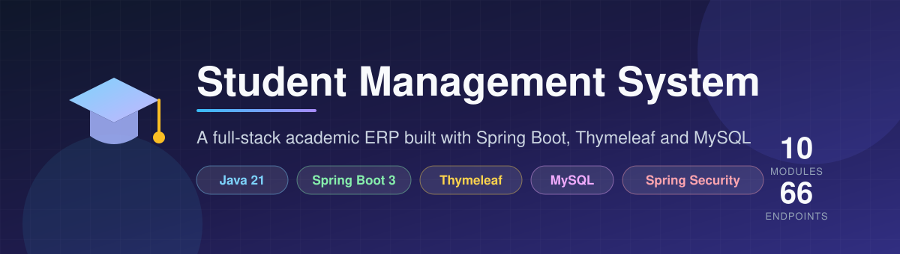
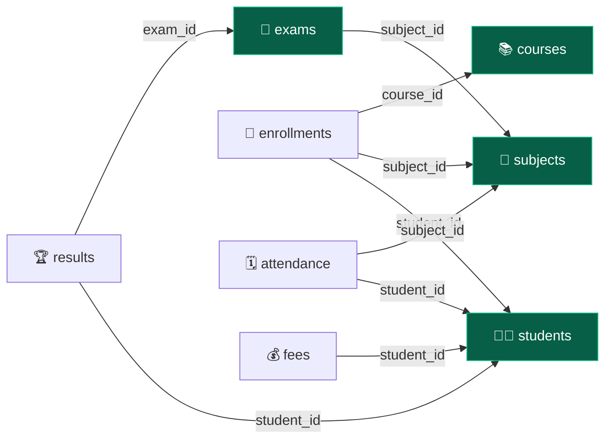
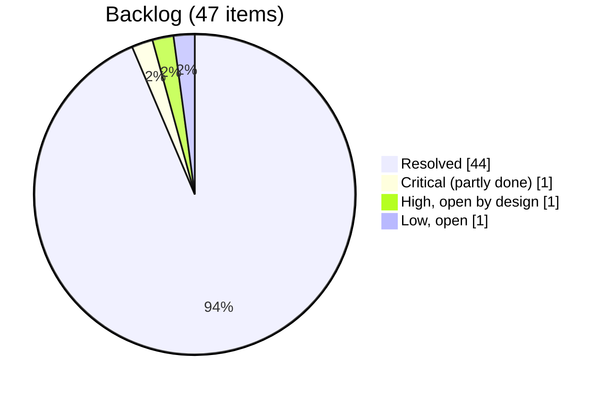
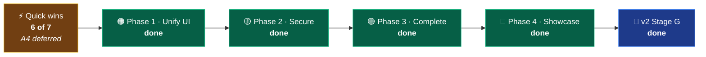

 

# 📋 Project Analysis

**Module-by-module inventory · code-health audit · engineering backlog**

*Last verified against source: **11 Oct 2026** · v1 Stages 0–F, v2 Stage G of the [Task Board](TASKS.md) and the [11 Oct audit](PROJECT_AUDIT_REPORT.md), on top of commit `5eb9b8e`*

[📘 README](README.md) · [🗺️ Roadmap](PROJECT_ROADMAP.md) · [✅ Task Board](TASKS.md) · [🧪 Backlog](#-engineering-backlog) · [🚧 Remaining Work](#-remaining-work) · [🔎 Audit Report](PROJECT_AUDIT_REPORT.md)

---

## 📑 Table of Contents

| | Section | | Section |
|:---:|---|:---:|---|
| 🩺 | [Health Check at a Glance](#-health-check-at-a-glance) | 🧪 | [Engineering Backlog](#-engineering-backlog) |
| 📐 | [Codebase by the Numbers](#-codebase-by-the-numbers) | 🧱 | [Stubs and Dead Code](#-stubs-and-dead-code) |
| 🧰 | [Tech Stack](#-tech-stack) | 📝 | [Documentation Drift](#-documentation-drift) |
| 🧩 | [Module Inventory](#-module-inventory) | 🚧 | **[Remaining Work](#-remaining-work)** |
| 🔗 | [Referential Integrity](#-referential-integrity) | 📊 | [Completion Summary](#-completion-summary) |
| 🔐 | [Security Review](#-security-review) | 🔬 | [How This Was Verified](#-how-this-was-verified) |

---

## 🩺 Health Check at a Glance

| Check | Result | Evidence |
|---|:---:|---|
| 🛠️ **Compile & package** | 🟢 Pass | `mvnw clean test` → `BUILD SUCCESS` |
| 🧪 **Test suite** | 🟢 117 passing | 21 classes: unit, `@DataJpaTest`, `@SpringBootTest` and `@WebMvcTest`, including sign-in and session tests through the real login form, on in-memory H2 |
| ⚙️ **CI** | 🟢 Configured | `.github/workflows/ci.yml` runs `./mvnw -B test` on Java 21 for every push and pull request |
| 🚀 **Startup** | 🟢 Pass | Boots against MySQL in under 15 s · **92** app endpoints (60 GET, 32 POST) |
| 🗄️ **Schema** | 🟢 Versioned | Flyway migrations V1–V7; Hibernate only validates (`ddl-auto=validate`). Run on an empty schema and on an existing one |
| 🔑 **Authentication** | 🟢 Solid | BCrypt, one 8–72 character password rule, CSRF on every POST form, POST logout, disabled or re-roled accounts signed out at once |
| 🛡️ **Authorization** | 🟡 Solid, viewing wide open | Admin / Teacher / Student URL rules plus `sec:authorize` in the UI · `RouteAccessTest` checks all 92 routes for every role on each build · any signed-in account can view every student (#38) |
| 🧮 **Business logic** | 🟢 Working | One `GradeCalculator` for results and marksheets · overdue fees · attendance % · notifications from live data |
| ✔️ **Form validation** | 🟢 Working | Bean Validation on every form and every CSV row; cross-field checks for marks, pass mark and duplicates; a length limit on every text field |
| 🔍 **Search & paging** | 🟢 Working | One paged query per module (5 per page, sorted by id); keyword and date filters combine |
| 🔗 **Referential integrity** | 🟢 Solid | Students link to a course, courses to their subjects, accounts to a student or teacher; every delete clears or refuses its dependants, and `DeleteCascadeTest` proves it |
| 🎨 **UI consistency** | 🟢 Complete | Every page renders through `layout.html`; one Bootstrap version; styled 403/404/409/413/500 pages |
| 📦 **Uploads** | 🟢 Hardened | JPEG/PNG decoded server-side after a 40-megapixel check, 2 MB cap, generated file names, old photo removed after a successful save |

> 🔄 **7–9 Oct 2026:** Stages B to F of the [Task Board](TASKS.md) closed **16 more issues**, including two of the
> three Critical ones (#3 roles, #4 GET deletes; #5 is half done), and added the whole feature set from
> roadmap phases 3 and 4. Working on them turned up four new low-severity issues (#34–#37).
>
> 🔄 **11 Oct 2026:** v2 Stage G closed **#33–#37**, put the schema under Flyway, made a student's course and a
> course's subjects real relationships, and linked accounts to students and teachers. Two bugs found on the way
> were fixed with it: the registration form gave a 500 page on any validation error, and saving a course would
> have wiped its subjects. Only #5 is open.
>
> 🔎 **11 Oct 2026, audit:** a full review ([report](PROJECT_AUDIT_REPORT.md)) logged **#38–#47** and fixed eight of
> them, each with a test that failed first: text over 255 characters lost the form behind the 409 page, an audit
> line could overflow after its change was saved, a student could get two results for one exam, the role
> rules had no automated test, and four smaller ones. **#38 stays open on purpose:** every signed-in account can
> view every student's records until Stage I.

---

## 📐 Codebase by the Numbers

<table>
<tr>
<td width="50%" valign="top">

**☕ Backend**

| Layer | Count |
|---|:---:|
| 🎯 Controllers | `14` (+ `NotificationAdvice`, `GlobalExceptionHandler`) |
| ⚙️ Service interfaces / impls | `14` / `14` (+ `CustomUserDetailsService`) |
| 🗄️ Repositories | `11` |
| 📦 JPA entities | `11` |
| 🔗 Relationships | `10` `@ManyToOne` · `2` `@OneToOne` · `1` `@ManyToMany` |
| 🔒 Unique constraints in the database | `11` |
| ✍️ `@Modifying` queries | `13` (11 deletes, 2 unlinks) |
| 📊 Aggregate `@Query`s | `7` (5 sums/counts, 2 attendance summaries) |
| 🔍 Search `@Query`s | `2` |
| 📨 DTOs and records | `7` |
| 🧰 Utilities | `6` (`GradeCalculator`, `CsvHelper`, `FileUploadUtil`, `Pages`, `PasswordPolicy`, `FieldLimits`) |
| 🔐 Security helpers | `2` (`CurrentUser`, `AccessRules`) |
| 🗄️ Flyway migrations | `7` |

</td>
<td width="50%" valign="top">

**🎨 Frontend, tests & totals**

| Item | Count |
|---|:---:|
| 🌐 HTTP endpoints | `92` (60 GET · 32 POST) |
| 🖼️ Thymeleaf templates | `57` |
| 💅 CSS files | `11` |
| ⚡ JS files | `4` |
| 🧪 Test classes / tests | `21` / `117` |
| 📄 Java files (main) | `90` |
| 📏 Lines of Java (main) | `8,704` |
| 📏 Lines of test Java | `2,534` |
| 📏 Templates · CSS · JS | `5,732` · `1,505` · `266` lines |

</td>
</tr>
</table>

---

## 🧰 Tech Stack

| Layer | Technology | Note |
|:---:|---|---|
| ☕ | Java **21** · Spring Boot **3.5.16** | Parent POM pins all Spring versions |
| 🔐 | Spring Security 6 · `thymeleaf-extras-springsecurity6` | Form login, BCrypt, role rules; `sec:authorize` gates the UI |
| 🗄️ | Spring Data JPA · Hibernate · MySQL (`sms_web`) | `ddl-auto=update`; constraints declared on the entities |
| 🎨 | Thymeleaf · Bootstrap **5.3.8** · Bootstrap Icons 1.11.3 · Chart.js 4.4.3 | One Bootstrap version; no Font Awesome or external image hosts |
| ✔️ | Jakarta Bean Validation | Every form, and every row of a CSV import |
| 📄 | OpenPDF **3.0.5** · Apache Commons CSV **1.14.1** | Marksheet and receipt PDFs; student import, student and fee export |
| 🧪 | JUnit 5 · AssertJ · Mockito · H2 · Spring Security Test | Tests need no MySQL |
| 🛠️ | Maven wrapper · GitHub Actions | `./mvnw -B test` in CI; the wrapper is executable for Linux |

---

## 🧩 Module Inventory

Every module has the full **entity → repository → service → controller** chain. The matrix shows how far
each one goes beyond that, and the cards below list what's built.

| # | Module | List | Form | Detail | Search | Paging | `@Valid` | Delete | Extras |
|:---:|---|:---:|:---:|:---:|:---:|:---:|:---:|:---:|---|
| 1 | 🔐 Auth & accounts | — | ✅ | ✅ profile | — | — | ✅ | — | roles · seeding · password change · user admin |
| 2 | 👨‍🎓 Student | ✅ | ✅ 📷 | ✅ | ✅ | ✅ | ✅ | ✅ cascade | marksheet + PDF · attendance % · CSV in/out |
| 3 | 👨‍🏫 Teacher | ✅ | ✅ 📷 | ✅ | ✅ 4 fields | ✅ | ✅ | ✅ | unique email |
| 4 | 📚 Course | ✅ | ✅ | ✅ | ✅ | ✅ | ✅ | ✅ cascade | unique code |
| 5 | 📖 Subject | ✅ | ✅ | ✅ exams | ✅ | ✅ | ✅ | ✅ cascade | unique code |
| 6 | 📝 Enrollment | ✅ | ✅ | ✅ | ✅ | ✅ | ✅ | ✅ | no duplicate enrollments |
| 7 | 🗓️ Attendance | ✅ | ✅ | ✅ | ✅ +date | ✅ | ✅ | ✅ | bulk entry · report |
| 8 | 💰 Fee | ✅ | ✅ | ✅ receipt | ✅ | ✅ | ✅ | ✅ | PDF · overdue flag · CSV out |
| 9 | 🧾 Exam | ✅ | ✅ | ✅ results | ✅ +date | ✅ | ✅ | ✅ cascade | schedule by month · pass rate |
| 10 | 🏆 Result | ✅ | ✅ | ✅ | ✅ | ✅ | ✅ | ✅ | grade engine · marks ≤ total |
| 11 | 📊 Dashboard | — | — | — | via navbar ✅ | — | — | — | notifications · recent activity |

📷 photo upload · cascade = dependent rows are cleared first (see [Referential Integrity](#-referential-integrity)) ·
+date = keyword and date filters combine

<b>🔐 1. Authentication & accounts</b>: login, roles, profile, user admin

 

- [x] `User` entity: `fullName`, `username` (unique), `email` (unique), BCrypt `password`, `role`, `enabled`, `createdAt`
- [x] Registration: duplicate guards, password confirmation, BCrypt, default `ROLE_STUDENT` (view-only)
- [x] `AdminSeeder` creates the first admin from `ADMIN_USERNAME` / `ADMIN_PASSWORD` when none exists
- [x] `SecurityConfig`: role rules, first match wins; `/admin/**` and `/fee/**` admin-only
- [x] `/profile`: own details and change password (`ChangePasswordDto`, current password checked, at least 8 characters)
- [x] `/admin/users`: list accounts, enable or disable, change role, by POST; admins can't change themselves
- [x] Every change is logged to the activity log

<b>👨‍🎓 2. Student</b>: CRUD, photos, marksheet, CSV

 

- [x] `Student` entity: `firstName`, `lastName`, `email` (unique), `phone` (10 digits), `gender`, `course` (a link to `Course` since G8), `dateOfBirth`, `address`, `photo`
- [x] `StudentController`: 13 routes, including `/{id}/marksheet`, `/{id}/marksheet.pdf`, `/import` and `/export`
- [x] Marksheet: totals, overall percentage and grade from `GradeCalculator`; a pass only if every exam is passed
- [x] Profile shows attendance %, with a "Below 75%" flag
- [x] CSV import validates each row (Bean Validation, email in the database or earlier in the file, existing course) and reports the rest; export uses the same header
- [x] Photos go through `FileUploadUtil`: decoded as JPEG/PNG, 2 MB cap, server-generated names

<b>👨‍🏫 3–6. Teacher · Course · Subject · Enrollment</b>

 

- [x] Detail pages for all four; the subject page lists its exams with Held / Upcoming
- [x] Unique teacher email, course code and subject code in the database; checked on create **and** edit (`existsBy…AndIdNot`)
- [x] An enrollment is unique per (student, course, subject)
- [x] Teacher search covers first name, last name, email and department

<b>🗓️ 7. Attendance</b>: daily, bulk, report

 

- [x] Keyword + date search, each optional, both must match
- [x] Bulk entry: pick a subject and date, mark the whole class; students already recorded are shown and skipped ("Saved N · skipped M")
- [x] Report: present out of total per student, optional subject filter, under 75% highlighted; same `AttendanceSummary` as the profile

<b>💰 8. Fee</b>: receipt, PDF, overdue

 

- [x] `amount` can't be negative
- [x] Detail page is a printable receipt (Fee Statement while unpaid); print styles hide the app shell
- [x] Receipt PDF; `Fee.isOverdue()` drives the list badge, the dashboard count and the notification
- [x] CSV export for spreadsheets, Excel-safe

<b>🧾 9–10. Exam · Result</b>: schedule, grading

 

- [x] Passing marks can't exceed total marks; obtained marks can't exceed the exam's total
- [x] Exam page lists its results with passed, failed and pass rate; schedule groups upcoming exams by month
- [x] Grade and status from `GradeCalculator`: a fail is F, a pass is never below D

<b>📊 11. Dashboard</b>: stats, charts, notifications, activity

 

- [x] Real stat cards, Chart.js gender and records charts, live clock
- [x] Navbar notifications from live data: overdue fees (admin), students under 75% (admin, teacher), exams in the next 7 days (everyone); computed lazily
- [x] Recent Activity panel for admins: the last 10 create, update, delete and import entries

---

## 🔗 Referential Integrity

The schema has **nine foreign keys**. A parent row can only be deleted after its children are removed,
so each `delete*()` method clears them first.

Arrows point from child to parent. Every arrow is cleared before its parent is deleted, so all four
parents (green) delete safely.

| Delete operation | Children cleared first | Outcome |
|---|---|:---:|
| `StudentServiceImpl.deleteStudent` | attendance → enrollments → fees → results, in one `@Transactional` | 🟢 Safe · tested |
| `SubjectServiceImpl.deleteSubject` | attendance → enrollments → results of its exams → exams | 🟢 Safe · tested |
| `CourseServiceImpl.deleteCourse` | enrollments | 🟢 Safe · tested |
| `ExamServiceImpl.deleteExam` | results | 🟢 Safe · tested |
| Teacher · Enrollment · Attendance · Fee · Result | no children | 🟢 Safe |

`DeleteCascadeTest` covers the four parent deletes and fails if a child delete is removed. Any other
constraint error now shows the styled **409** page from `GlobalExceptionHandler` instead of a 500.

---

## 🔐 Security Review

<table>
<tr>
<td width="50%" valign="top">

**✅ In place**

| Control | Detail |
|---|---|
| Roles | Admin / Teacher / Student URL rules; UI gated with `sec:authorize` |
| Password storage | BCrypt; change password checks the current one |
| Accounts | Disabled accounts can't sign in; admins can't disable or demote themselves |
| CSRF | On every POST form; deletes are POST only (GET → 405) |
| Uploads | Image decoded server-side, 2 MB cap, generated names, never the browser's file name |
| Errors | Styled 403 / 404 / 409 / 413 / 500 pages, no stack traces |
| Secrets | DB credentials and the first admin come from environment variables |
| Output escaping | No `th:utext`; no user data inside inline JavaScript |
| CSV export | Formula-looking cells prefixed with `'`, so Excel shows them as text |
| Logging | SQL and DEBUG logging only in the `dev` profile; no password is ever logged (#44) |
| Role rules | `RouteAccessTest` checks all 92 routes for every role on each build (#42) |
| Error text | Registration shows only its own messages, never the database's (#43) |

</td>
<td width="50%" valign="top">

**⚠️ Remaining**

| Gap | Issue |
|---|:---:|
| Any signed-in account, self-registered ones included, can view every student's records | #38 |
| Old DB password still in git history, not rotated | #5 |
| Password rule counts characters, BCrypt counts bytes | #47 |
| Old photos and password in git history (rewrite is Parked) | — |

</td>
</tr>
</table>

---

## 🧪 Engineering Backlog

> Numbering continues the register in [PROJECT_ROADMAP.md](PROJECT_ROADMAP.md#-engineering-backlog), so issue
> numbers match across both documents. 🆕 marks issues first found during Stages E–F, 🔎 those from the [11 Oct audit](PROJECT_AUDIT_REPORT.md). [Remaining Work](#-remaining-work)
> turns the open items into a checklist.

<b>✅ Resolved (44)</b>

 

| # | Issue | Fixed by | Resolved |
|:---:|---|---|:---:|
| 1 | Invalid derived query aborted Spring context at startup | `EnrollmentRepository` | `21 Sep 2026` |
| 2 | `deleteBySubjectId` targeted the wrong entity → FK violation | `EnrollmentRepository` | `21 Sep 2026` |
| 3 | No roles; self-registration got full rights | Admin / Teacher / Student rules, `AdminSeeder` (C7–C10) | `8 Oct 2026` |
| 4 | Deletes were GET links | POST forms with CSRF on all 9 lists (C4–C6) | `8 Oct 2026` |
| 6 | Only the dashboard used the shared layout | Every page through `LayoutView` (B4–B7) | `7 Oct 2026` |
| 7 | Uploads unchecked, served same-origin | `FileUploadUtil`, 2 MB cap, generated names (C12–C14) | `8 Oct 2026` |
| 8 | Whitelabel 500 for bad ids and FK errors | `GlobalExceptionHandler`, styled error pages (B1–B3) | `7 Oct 2026` |
| 9 | "Total Fees" displayed a record count | `FeeServiceImpl` | `21 Sep 2026` |
| 10 | "Upcoming Exams" listed the oldest exams | `ExamServiceImpl` | `21 Sep 2026` |
| 11 | Search bypassed pagination | One paged query per module (D1–D5) | `8 Oct 2026` |
| 12 | Exam and Result forms lacked `@Valid` | `ExamController` · `ResultController` | `6 Oct 2026` |
| 13 | Magic-date sentinel `1900-01-01` in search | Nullable `@Query` | `6 Oct 2026` |
| 14 | Navbar hardcoded "Admin User" | `common/navbar.html` | `21 Sep 2026` |
| 15 | Notifications hardcoded, badge always 3 | `NotificationService` + `NotificationAdvice` (F1–F2) | `8 Oct 2026` |
| 16 | Gender statistics never rendered | `stats-cards.html` · `charts.html` | `21 Sep 2026` |
| 17 | Two Bootstrap versions | 5.3.8 everywhere (B4, B15) | `7 Oct 2026` |
| 18 | Six empty stub classes | Unused DTOs and `DateUtil` deleted; `CsvHelper`, `FileUploadUtil` implemented (C12, D13, E17) | `8 Oct 2026` |
| 19 | `uploads/` committed | `.gitignore` + `git rm --cached` (C3) | `8 Oct 2026` |
| 20 | `webConfig` class name | Renamed `WebConfig` (B18) | `7 Oct 2026` |
| 21 | `footer.css` held HTML | `static/css/footer.css` | `21 Sep 2026` |
| 22 | Live clock had no elements | `welcome.css` · `welcome.html` | `21 Sep 2026` |
| 23 | Student search returned 500 | `StudentController` | `6 Oct 2026` |
| 24 | Logout was a GET that 404'd | POST form | `6 Oct 2026` |
| 25 | Course, exam and subject deletes violated FKs | Child deletes in one transaction | `6 Oct 2026` |
| 26 | Date-only search returned every row | AND-semantics `@Query` | `6 Oct 2026` |
| 27 | Uniqueness only on create, only in code | DB constraints + `existsBy…AndIdNot` (D6–D8) | `8 Oct 2026` |
| 28 | Marks and amounts unchecked; "Pass · F" possible | Cross-field checks, `@PositiveOrZero`, `GradeCalculator` (D9–D12) | `8 Oct 2026` |
| 29 | Debug output and DEBUG/TRACE logging by default | SLF4J, `application-dev.properties` (C1–C2) | `8 Oct 2026` |
| 30 | Dead code and config (Lombok, `/uploads/**` rule, unused methods) | Removed (B17) | `7 Oct 2026` |
| 31 | External runtime dependencies | Local avatar SVG, Bootstrap Icons only (B9, B10, B16) | `7 Oct 2026` |
| 32 | Edit forms opened with empty date boxes | `spring.mvc.format.date=iso` | `6 Oct 2026` |
| 33 | Raw "Failed to convert…" text for letters in a number field | `messages.properties` (G1) | `11 Oct 2026` |
| 34 | "Fees Collected" added up pending fees too | Paid-only sum, pending amount shown separately (G2) | `11 Oct 2026` |
| 35 | Single attendance form allowed duplicates | Form check plus a unique index, `V2__attendance_unique.sql` (G3) | `11 Oct 2026` |
| 36 | Registration accepted 6 characters, the change form 8 | One `PasswordPolicy`, 8 to 72 characters (G4) | `11 Oct 2026` |
| 37 | Sessions survived a disable or role change | `SessionRegistry` + `UserSessionService` (G5) | `11 Oct 2026` |
| 39 🔎 | Text over 255 characters failed in the database: the form was lost behind a 409 page saying nothing changed | `@Size` on every text field from one `FieldLimits`; three forms now show the message | `11 Oct 2026` |
| 40 🔎 | An audit line could overflow its column after the change was saved, so the user was told nothing changed (a 101+ character username could not change its password) | `ActivityLog` shortens lines to fit; usernames capped at 50 | `11 Oct 2026` |
| 41 🔎 | A student could get two results for one exam; the marksheet counted it twice | Form check plus a unique index, `V7__results_unique.sql` | `11 Oct 2026` |
| 42 🔎 | Role rules checked by hand (51 routes, 9 Oct) but not by any test; 8 automated 403 checks in all | `RouteAccessTest`: 92 routes × 3 roles and signed-out visitors; a new route without a rule fails | `11 Oct 2026` |
| 43 🔎 | Registration printed any exception's text, which can include SQL | Only the service's own messages are shown | `11 Oct 2026` |
| 44 🔎 | The demo seeder logged the demo password | Logs the setting's name, not its value | `11 Oct 2026` |
| 45 🔎 | An exam could be out of more than 1000, the most a result can hold | `@Max` from `GradeCalculator.MAX_MARKS` | `11 Oct 2026` |
| 46 🔎 | A photo was decoded before its size was checked: a small file could make the server allocate gigabytes (admin-only) | Refused over 40 megapixels before decoding | `11 Oct 2026` |

<b>🔴 Critical, partly done (1)</b>

 

| # | Issue | Location | Status |
|:---:|---|---|:---:|
| 5 | Database password committed in plaintext. Since 6 Oct it is read from `${DB_PASSWORD}`, and since 11 Oct the app signs in as its own `sms_app` user, limited to `sms_web` (G6). The leaked `root` password is still in git history and not yet rotated (task A4); only the other local projects use `root` now | `application.properties` history | 🟡 App off `root` |

<b>🟠 High, open by design (1)</b>

 

| # | Issue | Location | Status |
|:---:|---|---|:---:|
| 38 🔎 | Anyone can register, and every signed-in account can view every student's email, phone, address, date of birth, marks and attendance. Intended for v1 and scheduled for Stage I (I5), but it must be settled before real student data goes online (H7) | `SecurityConfig` · `AuthController` | 🟠 Needs a decision |

<b>🟡 Low, open (1)</b>

 

| # | Issue | Location | Status |
|:---:|---|---|:---:|
| 47 🔎 | The password rule counts characters (8 to 72), but BCrypt's limit is 72 **bytes**. A 30-character Hindi password (90 bytes) passes the rule, then the encoder refuses it with its own message; as `ADMIN_PASSWORD` it would stop startup. Fix: count UTF-8 bytes in `PasswordPolicy` and check it with a small custom constraint | `utility/PasswordPolicy` | 🟡 Open |

---

## 🧱 Stubs and Dead Code

None left. Every stub found in the 6 Oct audit was implemented or deleted:

| File | Then | Now |
|---|:---:|---|
| `utility/CscHelper.java` | ❌ Empty, misspelled | ✅ `CsvHelper`: student import and export, fee export (E17–E20) |
| `utility/FileUploadUtil.java` | ❌ Empty | ✅ Image validation, generated names, safe delete (C12) |
| `utility/DateUtil.java` | ❌ Empty | 🗑️ Deleted (D13) |
| `dto/CourseDTO` · `StudentDTO` · `TeacherDTO` | ❌ Empty | 🗑️ Deleted (D13); the `dto/` package now holds 7 classes that are all used |
| Unused repository methods | ⚠️ Dead | 🗑️ Removed (B17) |

---

## 📝 Documentation Drift

Statements in the companion documents that had stopped matching the source, and when they were corrected.

| Claim | Where | Actual | Status |
|---|---|---|:---:|
| "Eight foreign-key relationships" | README · Roadmap | **Nine** | ✅ Fixed 7 Oct |
| `UK` markers on codes and teacher email | ER diagrams | Removed 7 Oct while untrue; **restored 9 Oct** now that D6 added the constraints | ✅ Fixed |
| "66 endpoints · 36 templates · 10 entities · 4.5k lines" | README · Roadmap · this file | **88 · 57 · 11 · 7.4k** after Stages B–F | ✅ Fixed 9 Oct |
| "Tests: 1 passing" · static "Build passing" badge | All three | **55 tests**; the badge is now the real GitHub Actions status | ✅ Fixed 9 Oct |
| Routes table with `GET /delete/{id}` | README | Deletes are POST since C4; table rebuilt from the controllers | ✅ Fixed 9 Oct |
| "Role-based access: planned" · "notifications still static" | README · Roadmap | Both shipped (C7–C10, F1–F2) | ✅ Fixed 9 Oct |
| "51/51 route × role checks pass" | This file | True on 9 Oct, by hand on a running copy; no test re-checked it, and the app now has 92 routes | ✅ Automated 11 Oct (#42) |
| "last verified against source on 9 Oct 2026" | README footer | The other documents said 11 Oct | ✅ Fixed 11 Oct |

---

## 🚧 Remaining Work

> The [Task Board](TASKS.md)'s 101 tasks are done except **A4** (rotate the old password), which is deferred.
> What's left is the open backlog above plus the Parked items.

### ✅ Done (Stages 0–F)

- [x] **Quick wins**: student search, logout, the three failing deletes, date-only search, Exam/Result validation, docs corrected
- [x] **Phase 1 · Unify the UI** (#6, #8, #17, #20, #30, #31): shared layout, error pages, one Bootstrap, no external dependencies, dead code removed
- [x] **Phase 2 · Security** (#3, #4, #7, #19, #29): roles, POST deletes, hardened uploads, `uploads/` untracked, dev logging profile
- [x] **Phase 3 · Feature set** (#11, #18, #27, #28): paging, uniqueness, marks checks; detail pages, marksheet, receipt, overdue fees, attendance % and report, exam schedule, bulk attendance, CSV import and export
- [x] **Phase 4 · Showcase** (#15): notifications, activity log, PDFs, profile and password, user admin, 55 tests, CI, screenshots

### ✅ Done in v2 Stage G (11 Oct 2026)

- [x] **Small fixes** (#33–#36): type-mismatch messages, "Fees Collected" counting only paid fees, the single attendance form's duplicate check, one password rule
- [x] **End sessions on disable or role change** (#37)
- [x] Flyway migrations, `Student → Course` and `Course ↔ Subject` relationships, accounts linked to people, demo data

### 🔜 Still open

- [x] **Give the app its own MySQL user** (G6): `sms_app`, with rights on `sms_web` only
- [ ] **Rotate the old `root` password** (#5, task A4). It no longer affects this app, only the other local projects that use `root`
- [ ] **Decide who may view student records before going public** (#38). Stage I's I5 limits students to their own records; until then, either keep the public demo on made-up data or make new accounts wait for an admin's approval
- [ ] **Count password bytes, not characters** (#47), so a non-English password over 72 bytes gets the policy's message

### ✅ Done in the 11 Oct audit

- [x] **Eight fixes, each with a test that failed first** (#39–#46): length limits on every text field, audit lines that can't overflow, one result per student and exam (V7), every route × role tested, no SQL text on the registration page, no password in the logs, exam totals capped at 1000, photos measured before decoding

### 🧊 Parked

Recorded but deliberately unscheduled in v1, because each needs a schema migration or an outside service. Most are
now scheduled in [Roadmap v2](PROJECT_ROADMAP.md#-roadmap-v2): the course and subject links (G8, G9), own records
only (G10, I4, I5), password reset (L2), migrations (G7), the REST API (Stage N), Docker (H1, H2) and monitoring (P1, P2).
History rewriting stays parked.

- ~~`Student.course` as a real foreign key to `Course`, and a Subject → Course link~~ done in G8 and G9
- Students seeing only their own records: the User → Student link exists since G10; the pages come in Stage I
- Forgot / reset password, which needs a mail server
- Removing the old password and photos from git history (`git filter-repo`), which rewrites published history
- The production concerns in the roadmap's [Future Scope](PROJECT_ROADMAP.md#-future-scope): migrations, REST API, Docker, monitoring

---

## 📊 Completion Summary

| Module | Backend | Frontend | Status | Notes |
|---|:---:|:---:|:---:|---|
| 🔐 Auth & accounts | ✅ | ✅ | 🟢 | Roles, seeding, profile, password change, user admin |
| 👨‍🎓 Student | ✅ | ✅ | 🟢 | CRUD, detail, marksheet + PDF, attendance %, CSV |
| 👨‍🏫 Teacher · 📚 Course · 📖 Subject · 📝 Enrollment | ✅ | ✅ | 🟢 | Detail pages, uniqueness enforced |
| 🗓️ Attendance | ✅ | ✅ | 🟢 | Bulk entry, report, detail |
| 💰 Fee | ✅ | ✅ | 🟢 | Receipt + PDF, overdue, export; dashboard splits collected and pending |
| 🧾 Exam · 🏆 Result | ✅ | ✅ | 🟢 | Schedule, pass rate, grade engine, marks checks |
| 📊 Dashboard | ✅ | ✅ | 🟢 | Live data, notifications, recent activity |
| 🎨 Shared layout | ✅ | ✅ | 🟢 | Every page, print styles |
| 🛡️ Roles/permissions | ✅ | ✅ | 🟡 | All 92 routes × 3 roles tested; viewing open to every account until Stage I (#38) |
| 📥 CSV · 🖨️ PDF | ✅ | ✅ | 🟢 | Import, two exports, two PDFs |
| 🧪 Tests · ⚙️ CI | ✅ | — | 🟢 | 117 tests, every route × role, GitHub Actions |

> Every feature in roadmap phases 1–4 is built, and Stage G closed the five low-severity issues found along the
> way. The 11 Oct audit fixed eight more (#39–#46). What's open is one chore (#5), rotating the leaked `root`
> password, which this app no longer uses; one decision (#38), who may view student records before the app
> goes online with real data; and one rare edge case (#47) in the password rule.

---

## 🔬 How This Was Verified

| Step | Method | Result |
|---|---|---|
| 🛠️ Build & tests | `mvnw clean test` with `DB_PASSWORD` unset, so only H2 is reachable | `BUILD SUCCESS` · 117 tests, 0 failures, 0 errors (100 before the audit, 55 on 9 Oct) |
| 🧬 Tests have teeth | Removed `ExamServiceImpl`'s results delete and re-ran `DeleteCascadeTest` | Fails with H2's referential-integrity error, as it should |
| 🌐 Route count | Every `@GetMapping`/`@PostMapping` in `controller/`, with class prefixes | 92 endpoints (60 GET, 32 POST); the README route table adds up to 92 |
| 🛡️ Roles | Each route requested as Admin, Teacher and Student against a second instance on `:8081` (9 Oct); since 11 Oct `RouteAccessTest` on every build | 51/51 on 9 Oct; now 92 routes × 3 roles plus signed-out visitors. With the fee rule deleted on purpose, the test failed on all 16 teacher and student fee requests |
| 🗄️ Migrations (11 Oct) | V1–V6 run on an empty MySQL schema; then `sms_web` backed up, baselined at V1 and migrated to V6 | Hibernate validation passes on both; every student kept the course their text named |
| 🧱 Stage G (11 Oct) | 20 browser-level checks with curl against the demo data on MySQL, one cookie jar per person | 20 of 20 pass, including the sign-out of a disabled account on its next request |
| 🔑 G6 (11 Oct) | `SHOW GRANTS` as root; `sms_app` asked for `sms_web` and for another project's database; the app started as `sms_app` | Only `sms_web`; the other database refused it (error 1044); Flyway found the schema up to date |
| 🧪 Stages B–F | Each task reproduced or exercised on `:8081`, checked in headless Edge, with made-up `@example.com` data and dedicated `qa_*` accounts | Every check passes; temporary records deleted afterwards |
| 📄 PDFs and CSV | PDFs rendered and read back; exports opened in Excel; an export imported into an empty throwaway schema | Same facts as the pages · numbers and dates typed correctly · 16 of 16 rows identical |
| 🔎 Audit fixes (11 Oct) | A test written first for each of #39–#46 and seen to fail; then V1–V7 run on an empty MySQL schema, V7 run against a planted duplicate, and the app started on `:8091` with the demo profile and checked with curl | All 17 new tests pass after the fixes · V7 refused the duplicate (error 1062) and changed nothing · on MySQL a second result and a 300-character description each came back to the form with their message |
| 🐧 Linux readiness | Every template and static path compared with the files on disk, case-sensitively; `mvnw` checked for LF endings and given the executable bit | 111 references, 0 mismatches |

The user's own app on `:8080` and the shared MySQL `root` account were never changed. The throwaway
schemas (`sms_e19_check`, `sms_g7_check`, `sms_demo_check`, `sms_v7_check`) were dropped afterwards. Before V7 was written,
a read-only query showed `sms_web` holds no duplicate results, so V7 will apply there on the next start.
